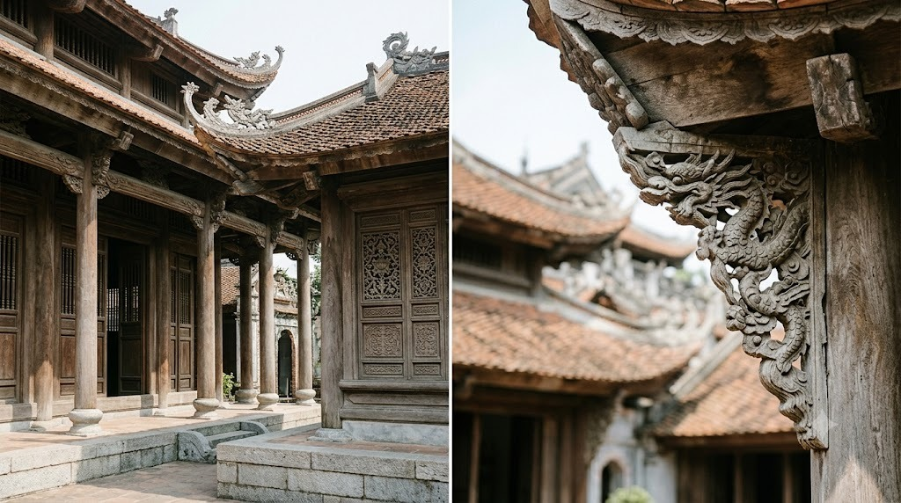

Nhà thờ, chùa, đình, miếu thường có hoa văn/chi tiết chạm khắc rất đẹp -
nhưng chụp cả toà nhà từ xa đôi khi lại không truyền tải được hết vẻ đẹp
đó. Vài mẹo giúp ảnh "có hồn" hơn.

### 1. Dùng khung cửa/mái vòm làm khung cho ảnh (framing)

Đứng trong 1 khung cửa, cổng tam quan, hoặc dưới mái vòm rồi chụp cảnh phía
xa qua khung đó - kỹ thuật "khung trong khung" (framing) này giúp mắt
người xem tập trung ngay vào chủ thể chính, đồng thời tạo chiều sâu cho
bức ảnh.

Nguyên lý: vùng khung cửa/mái vòm tối bao quanh,
công trình chính nằm trong vùng sáng chính giữa.

Ví dụ ảnh thật: đứng trong 1 cổng/mái vòm tối, chụp
công trình chính sáng rõ ở giữa khung - vừa có khung, vừa có độ sâu.

### 2. Chụp cận chi tiết chạm khắc, hoa văn

Đừng chỉ chụp toàn cảnh - những chi tiết nhỏ (hoa văn gỗ, phù điêu, mái
ngói cong, tượng...) thường là thứ làm nên nét riêng của mỗi công trình cổ.
Lại gần, chụp cận 1 góc chi tiết cũng ra 1 bức ảnh đẹp không kém toàn cảnh.

Một khung hình lấy cả không gian, một khung hình tập trung vào hoa văn rồng và mái ngói để thấy rõ nét riêng của công trình.

### 3. Tôn trọng không gian - tắt flash, giữ yên lặng

Nhiều nơi thờ tự không cho phép dùng flash hoặc chụp ảnh trong khu vực
hành lễ. Luôn để ý biển báo, hỏi người quản lý nếu không chắc, và giữ
khoảng cách lịch sự với người đang hành lễ/cầu nguyện khi chụp.

### 4. Canh giờ vắng người (sáng sớm) để có khung hình sạch

Các điểm nổi tiếng thường đông khách tham quan vào giữa trưa/cuối tuần.
Đi vào sáng sớm vừa có ánh sáng dịu, vừa dễ chụp được khung hình không bị
người qua lại che khuất công trình chính.
