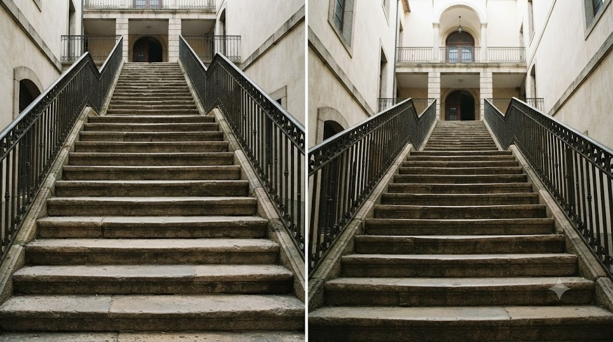
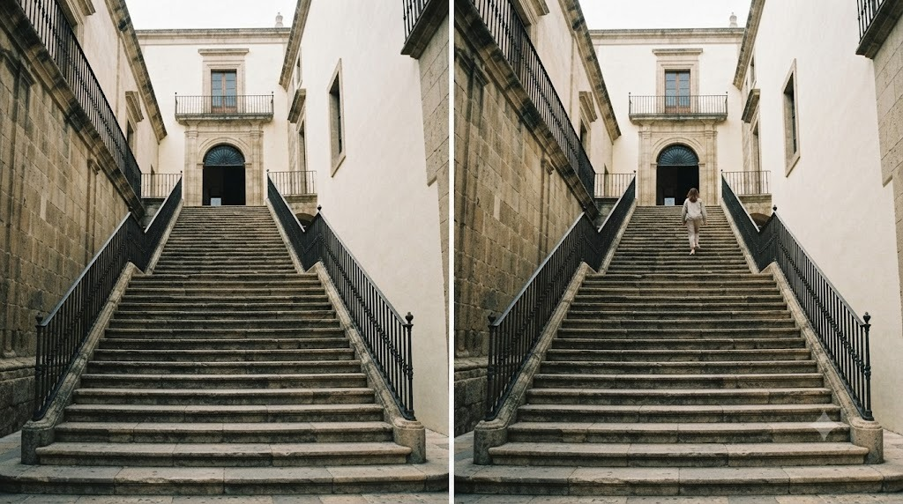

Cầu thang xoắn ốc, con dốc dài hun hút là chủ đề cực kỳ hợp để luyện mắt
nhìn bố cục - vì bản thân chúng đã có sẵn những đường nét lặp lại rất đẹp,
chỉ cần biết đứng đúng chỗ.

### 1. Cầu thang xoắn: chụp thẳng từ tâm nhìn xuống/lên

Đứng ngay giữa tâm cầu thang xoắn ốc, chĩa máy thẳng xuống (hoặc thẳng lên)
- các bậc thang sẽ tạo thành vòng xoáy đối xứng rất ấn tượng. Mẹo nhỏ: giữ
điện thoại CÀNG SONG SONG với mặt sàn/trần càng tốt để vòng xoáy không bị
méo lệch 1 bên.

Lệch tâm dù chỉ 1 chút cũng làm vòng xoáy mất cân
đối ngay - luôn canh 2 đường chéo giữa khung hình trước khi chụp.

### 2. Con dốc dài: đứng thấp để dốc trông "cao hơn"

Chụp con dốc/đường leo núi từ vị trí đứng thẳng bình thường thường làm độ
dốc trông ít ấn tượng hơn thực tế. Hạ thấp máy gần sát mặt đường (ống kính
gần song song mặt dốc) sẽ khiến con dốc trông dựng đứng, gây ấn tượng
mạnh hơn nhiều so với góc nhìn ngang tầm mắt thông thường.

### 3. Tận dụng các bậc thang làm đường dẫn

Mỗi bậc thang là 1 đường kẻ tự nhiên - đứng ở đầu hoặc cuối cầu thang (thay
vì đứng ngang giữa) để các bậc thang xếp hàng dẫn mắt người xem từ góc này
sang góc kia của khung hình, giống hệt nguyên lý "đường dẫn" (leading
lines) đã nói ở bài kiến trúc hiện đại.

Đứng ở đầu hoặc cuối cầu thang giúp các bậc xếp lớp
liên tiếp, lan can tạo hai đường dẫn và dẫn mắt về cửa ở phía xa.

### 4. Thêm 1 người đang bước đi để có tỉ lệ + chuyển động

Một cầu thang/con dốc trống trơn tuy có đường nét đẹp nhưng thiếu "câu
chuyện". Chụp đúng lúc có người đang bước lên/xuống (ở xa, nhỏ trong khung)
vừa giúp người xem hình dung độ cao/dốc thực tế, vừa thêm cảm giác chuyển
động cho bức ảnh.

Một người nhỏ trong khung vừa tạo mốc tỉ lệ cho độ cao
cầu thang, vừa khiến bức ảnh có câu chuyện và cảm giác chuyển động.

