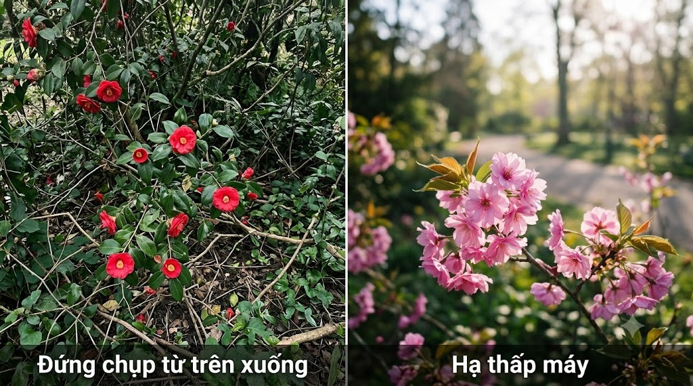
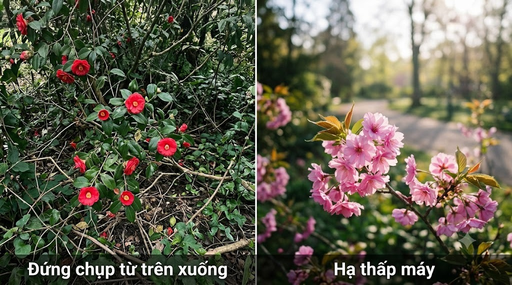
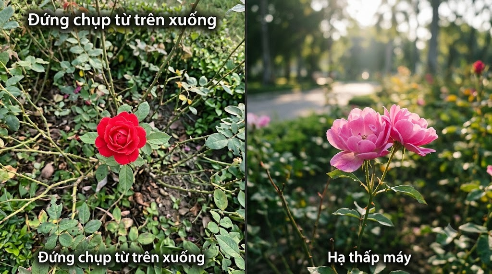
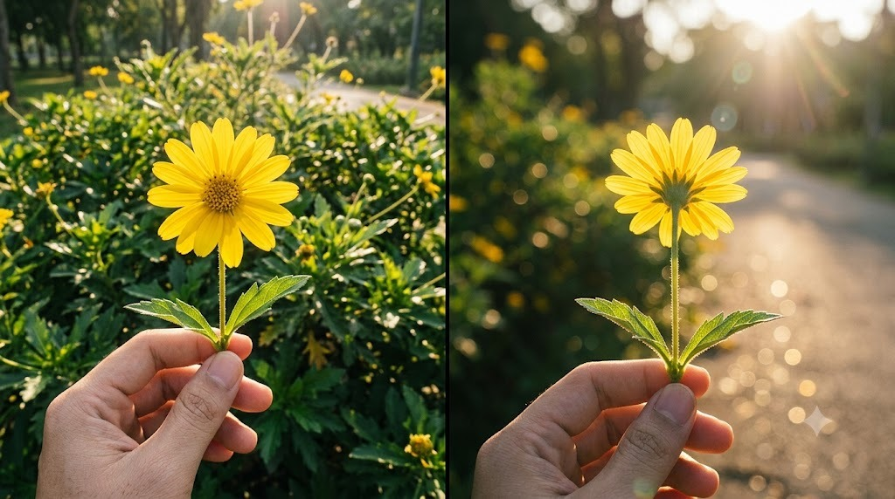
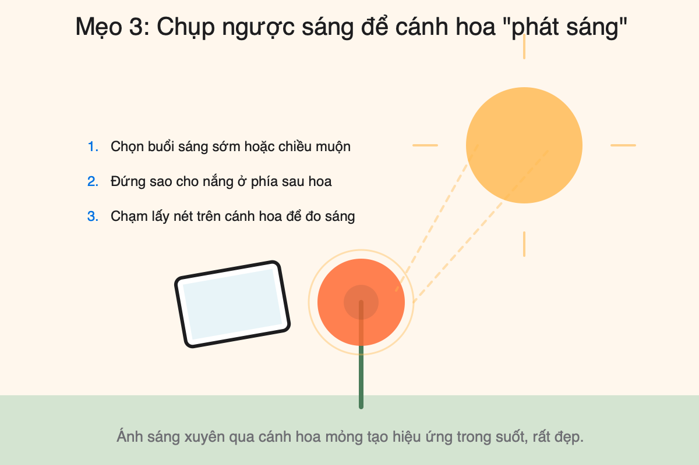
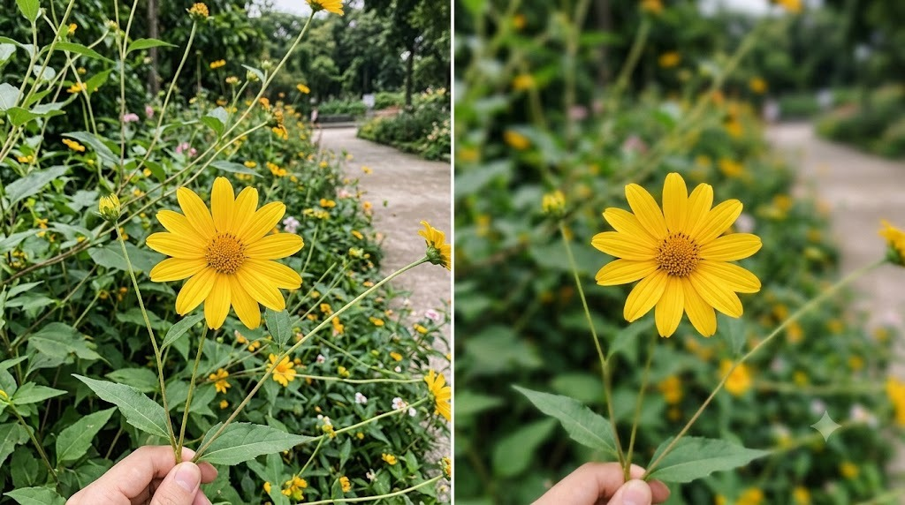
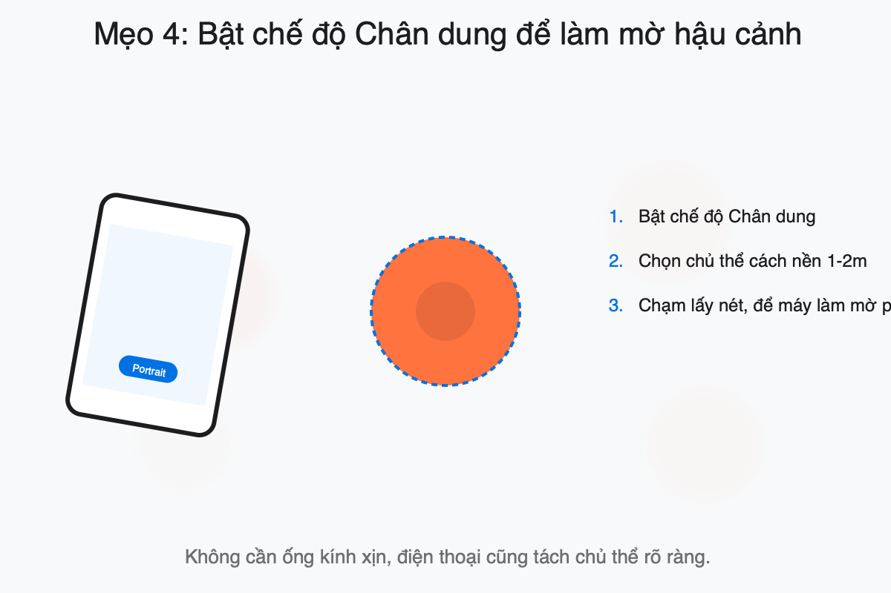

Chụp hoa nghe thì dễ — đứng yên, bấm nút, xong. Nhưng nếu không để ý, ảnh
hay bị "phẳng": một đống màu xanh đỏ lẫn lộn, chẳng có điểm nhấn. Dưới đây
là vài mẹo nhỏ giúp bông hoa của bạn nổi bật hơn ngay lập tức.

### 1. Chọn 1 bông/1 khóm làm chủ thể, đừng chụp "cả vườn"

Một khung hình ôm trọn cả luống hoa thường rối mắt vì quá nhiều chi tiết
chen nhau. Hãy chọn 1 bông đẹp nhất (không héo, không bị che khuất) làm
"nhân vật chính", để những bông còn lại lùi ra phía sau làm nền mờ.

Bên trái là khung hình rối mắt; bên phải chọn một khóm hoa làm nhân vật chính và để phần còn lại lùi vào nền.

### 2. Hạ thấp máy xuống ngang tầm hoa

Đứng chụp từ trên xuống là góc nhìn quen thuộc mỗi ngày, nên ảnh dễ trông
bé và tầm thường. Thử ngồi hoặc cúi xuống, đưa máy ngang tầm bông hoa —
góc nhìn lạ hơn, hậu cảnh phía sau cũng dễ mờ tự nhiên vì khoảng cách xa
dần.

  <figure>
    
    <figcaption>Đứng từ trên xuống khiến hoa nhỏ và lẫn vào nền.</figcaption>
  </figure>
  <figure>
    
    <figcaption>Hạ máy ngang tầm hoa giúp chủ thể nổi bật và hậu cảnh dễ mờ hơn.</figcaption>
  </figure>

**Hướng dẫn:**

Ngồi hoặc cúi xuống, đưa máy ngang tầm hoa để góc nhìn lạ hơn, hậu cảnh mờ tự nhiên.

### 3. Chụp ngược sáng để lá/cánh hoa "phát sáng"

Buổi sáng sớm hoặc chiều muộn, hãy thử đứng sao cho nắng chiếu từ phía sau
hoa về phía máy. Ánh sáng xuyên qua cánh hoa/lá mỏng tạo hiệu ứng "phát
sáng" rất đẹp. Chỉ cần chạm tay vào cánh hoa trên màn hình để đo sáng lại
(xem thêm mẹo trong bài "Chụp ảnh thiếu sáng").

Bên trái là ánh sáng trực tiếp từ trước; bên phải là ánh sáng phía sau giúp cánh hoa có độ trong và nổi bật.

**Hướng dẫn:**

Đứng sao cho nắng ở phía sau hoa, chạm lấy nét trên cánh hoa.

### 4. Bật chế độ Chân dung để làm mờ hậu cảnh

Nếu điện thoại có chế độ Chân dung (Portrait), bật lên khi chụp cận một bông
hoa. Hậu cảnh lá/hoa phía sau sẽ mờ nhẹ, giúp bông hoa chính tách hẳn khỏi
đám rối mà không cần ống kính xịn.

Giữ bông hoa ở tiền cảnh, cách nền một khoảng rồi bật Portrait để hậu cảnh mờ nhẹ và chủ thể nổi bật hơn.

**Hướng dẫn:**

Bật Portrait → chọn chủ thể cách nền 1-2m → chạm lấy nét.

**Thử ngay đi!** Lần tới đi qua vườn hoa, áp dụng 1 trong 4 mẹo trên và xem
ảnh của bạn khác biệt thế nào.
