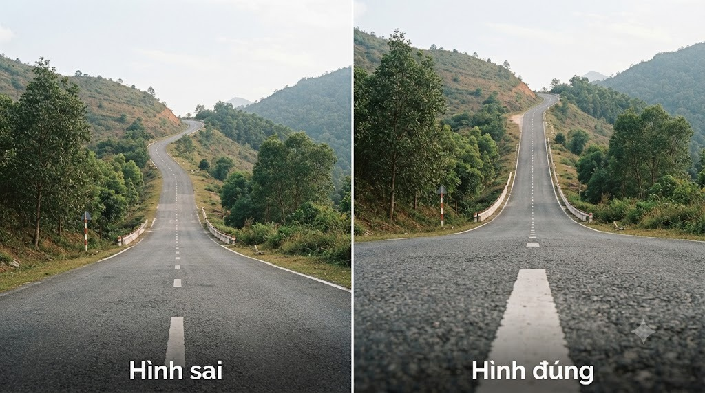
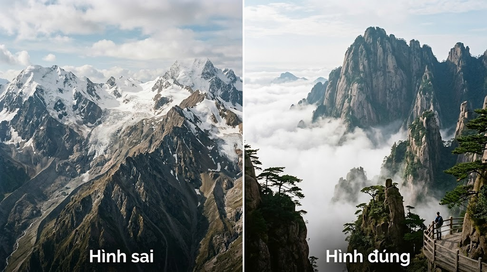
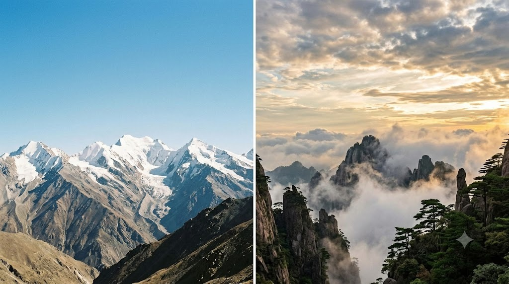
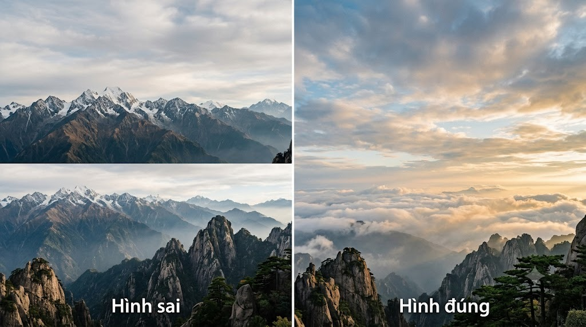

Núi thường rất đẹp khi đứng ngắm trực tiếp, nhưng lên ảnh lại dễ bị "phẳng
lì", trông nhỏ hơn thực tế rất nhiều. Vấn đề thường nằm ở việc thiếu vật gì
đó để mắt người xem so sánh tỉ lệ.

### 1. Luôn có tiền cảnh (foreground)

Đừng chỉ chụp mỗi dãy núi chiếm trọn khung hình - thêm vào tiền cảnh 1 tảng
đá, bụi cây, hay con đường mòn ở phía dưới khung hình. Tiền cảnh giúp ảnh
có 3 lớp (gần - giữa - xa) thay vì phẳng 1 lớp, tạo cảm giác chiều sâu rõ
rệt hơn hẳn.

Núi càng xa càng nhạt màu (hiệu ứng khí quyển) -
tận dụng cùng với 1 vật tiền cảnh sẫm màu để tạo chiều sâu rõ rệt.

### 2. Con dốc dài: đứng thấp để dốc trông “cao hơn”

Với một con dốc hoặc đoạn đường leo núi, góc máy quyết định cảm giác dốc
cao đến đâu. Nếu đứng quá cao hoặc chụp ngang tầm mắt, mặt đường bị thu ngắn
và con dốc trông khá phẳng. Hạ điện thoại xuống gần mặt đường, để một đoạn
vạch kẻ hoặc mặt đường chạy từ sát mép dưới khung lên phía xa. Các đường
thẳng hội tụ sẽ dẫn mắt người xem đi lên và làm độ dốc nổi bật hơn.

Góc máy thấp giữ lại phần mặt đường ở tiền cảnh, tạo đường
dẫn mạnh và khiến con dốc có cảm giác dài, cao hơn. Khi chụp, nhớ đứng ở vị
trí an toàn, tránh giữa lòng đường.

### 3. Đưa người/vật nhỏ vào khung để thấy tỉ lệ

Núi to cỡ nào cũng khó cảm nhận nếu trong ảnh không có gì để so sánh. Chỉ
cần 1 người đứng nhỏ ở góc khung hình (theo quy tắc 1/3) là người xem lập
tức hình dung được núi lớn tới mức nào.

Một người nhỏ ở lối đi tạo mốc so sánh, giúp người xem cảm nhận rõ quy mô của dãy núi.

### 4. Chụp lúc trời có mây để bầu trời "có chuyện"

Bầu trời trong xanh không 1 gợn mây tuy đẹp mắt khi đứng ngắm, nhưng lên
ảnh lại trông trống trải. Trời có vài đám mây (đặc biệt lúc sáng sớm/chiều
muộn với ánh sáng vàng) giúp phần bầu trời có thêm chi tiết, hài hoà với
phần núi phía dưới.

Mây và ánh sáng cuối ngày làm bầu trời có lớp lang, giúp ảnh núi bớt trống trải và có không khí hơn.

### 5. Đừng đặt đường chân trời ngay chính giữa

Áp dụng quy tắc 1/3 (xem bài riêng về chủ đề này): nếu bầu trời đẹp, đặt
đường chân trời ở khoảng 1/3 phía dưới khung hình để dành nhiều đất cho
bầu trời; nếu núi/tiền cảnh ấn tượng hơn, đặt đường chân trời ở 1/3 phía
trên.

Đặt đường chân trời lệch 1/3 để ưu tiên phần đang có chi tiết và cảm xúc hơn: bầu trời hoặc dãy núi.

