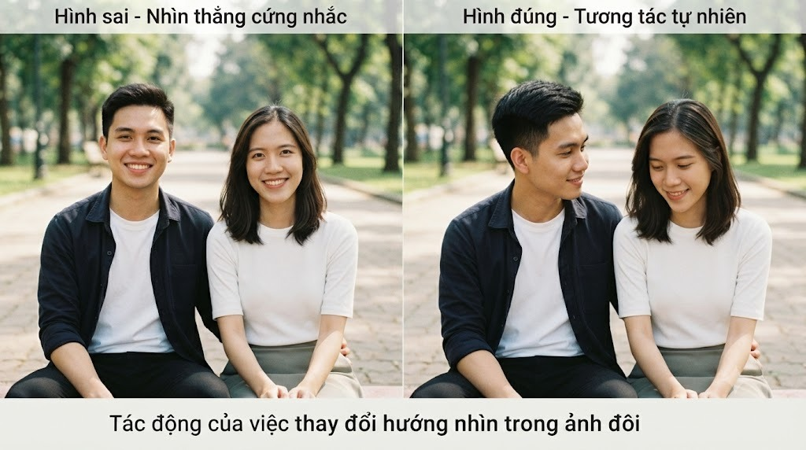

Chụp nhiều người cùng lúc dễ gặp lỗi: người đứng thẳng hàng cứng nhắc,
hoặc có người bị khuất/mờ vì máy lấy nét nhầm chỗ khác.

### 1. Đừng đứng thẳng hàng ngang - so le chiều cao/khoảng cách

Xếp cả nhóm đứng thành 1 hàng ngang bằng vai nhau trông khá cứng và "ảnh
thẻ". Thử để 1-2 người đứng lùi lại phía sau 1 chút, hoặc người cao/thấp
xen kẽ nhau - bố cục sẽ tự nhiên và có chiều sâu hơn nhiều.

So le vị trí (người lùi sau, người tiến trước, cao
thấp xen kẽ) giúp bố cục mềm mại và có chiều sâu hơn đứng thẳng hàng.

Không cần tạo dáng phức tạp: chỉ cần thay đổi nhẹ chiều
cao, khoảng cách và hướng nhìn là nhóm đã tự nhiên hơn.

### 2. Chụp đôi: không nhất thiết phải quay mặt thẳng vào máy

Một người quay mặt vào máy, người còn lại quay nghiêng nhìn về phía bạn
đồng hành (hoặc cả hai cùng nhìn về 1 hướng xa xăm) thường ra ảnh có cảm
xúc hơn là cả 2 cùng cười thẳng vào ống kính.

Chỉ cần thay đổi hướng nhìn — một người nhìn máy, một
người nhìn bạn đồng hành — là bức ảnh đã có tương tác và cảm xúc hơn.

### 3. Chạm lấy nét đúng vào gương mặt người ở giữa/phía trước

Khi nhiều người đứng cách máy không đều nhau, điện thoại dễ tự lấy nét
nhầm vào người ở xa hoặc vào hậu cảnh. Luôn chạm tay vào đúng gương mặt
người quan trọng nhất (hoặc người ở giữa khung hình) trước khi bấm chụp.

Khi khoảng cách giữa các thành viên khác nhau, hãy chạm
vào đúng gương mặt quan trọng nhất trước khi chụp để chủ thể chính sắc nét.

### 4. Chụp nhiều tấm liên tiếp, không chỉ 1 tấm

Với nhóm từ 3 người trở lên, xác suất có ít nhất 1 người nhắm mắt/cười
không tự nhiên trong 1 tấm là khá cao. Luôn chụp liên tiếp 3-5 tấm rồi chọn
tấm đẹp nhất, thay vì chỉ chụp đúng 1 lần.
