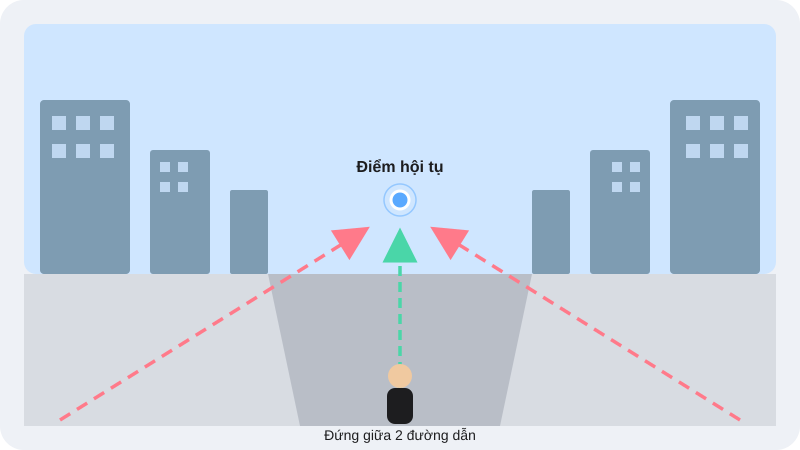
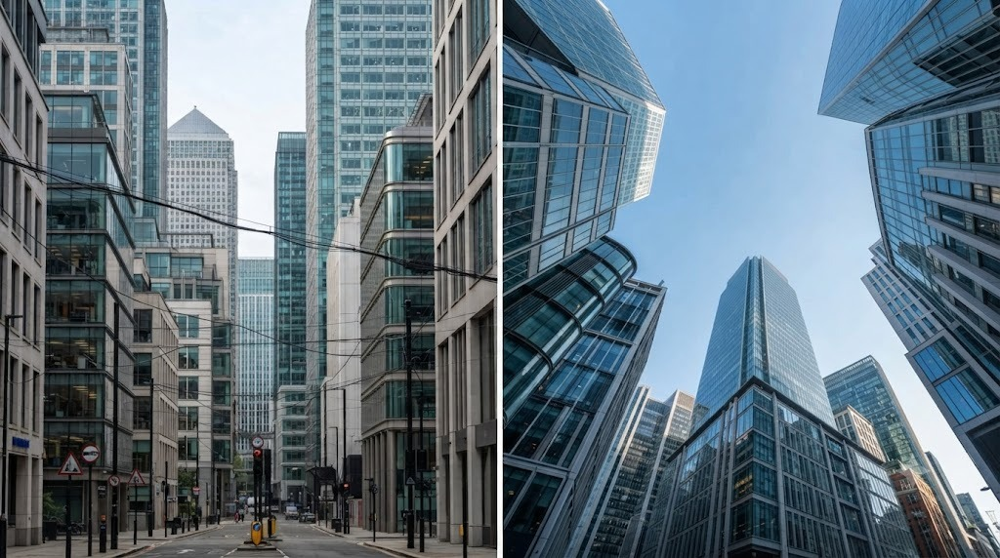
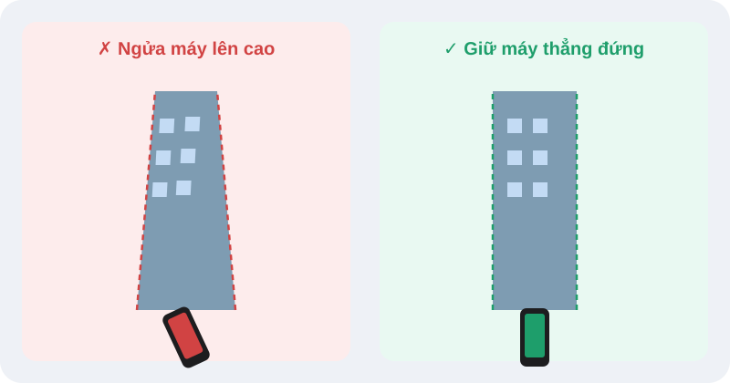
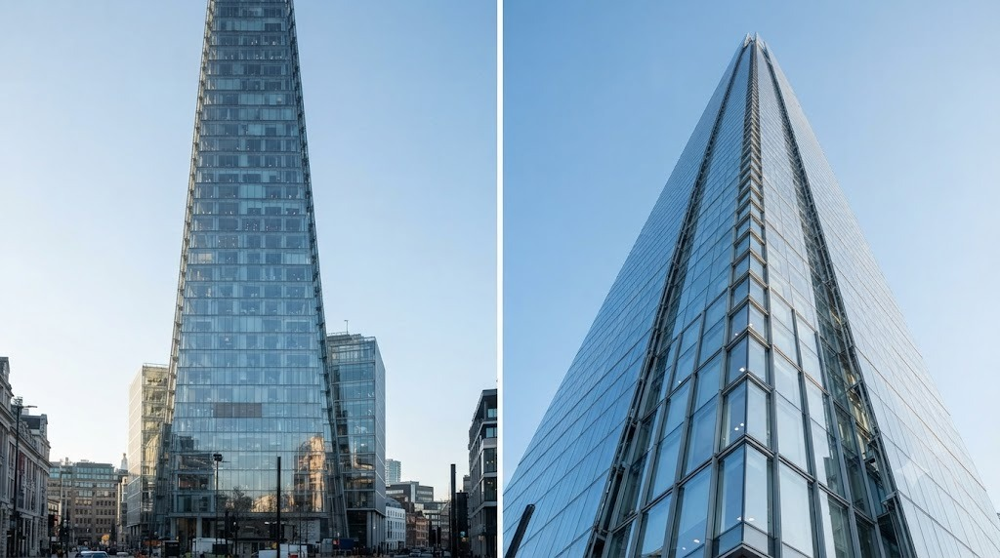
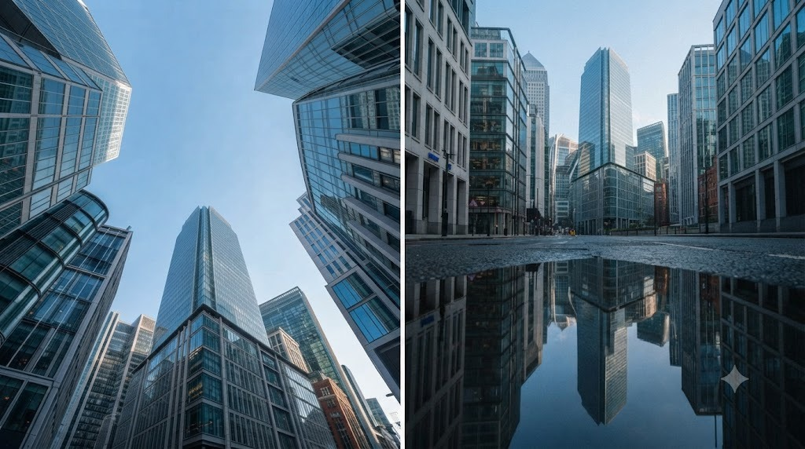
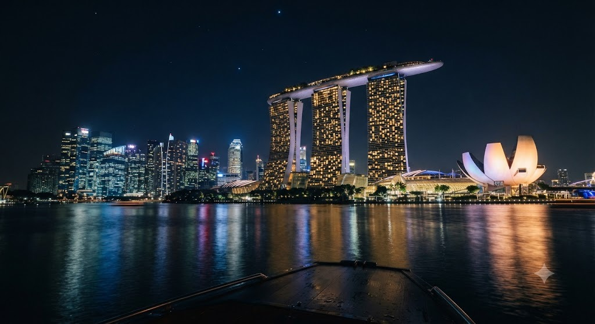
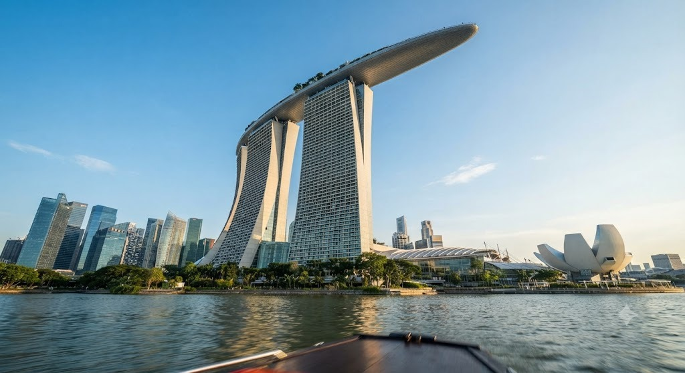

Kiến trúc hiện đại (toà nhà kính, cầu, phố xá) có sẵn rất nhiều đường
thẳng, hình khối - tận dụng đúng cách là có ngay bố cục đẹp mà không cần
chỉnh sửa gì thêm.

### 1. Tận dụng đường dẫn (leading lines)

Đường kẻ vỉa hè, hàng cột, lan can, hay đường chân trời của toà nhà đều có
thể dùng làm "đường dẫn" hướng mắt người xem từ cạnh khung hình tới chủ
thể chính. Đứng sao cho các đường này chạy chéo vào trong ảnh thay vì cắt
ngang giữa khung hình.

Đứng ngay chính giữa con đường/dãy nhà - 2 bên tự
tạo thành đường dẫn chéo hội tụ về 1 điểm phía xa, kéo mắt người xem vào
chủ thể.

Có thể dùng đường phố để dẫn mắt về phía xa, hoặc ngẩng
máy có chủ ý để các mặt kính hội tụ vào khoảng trời ở giữa.

### 2. Căn thẳng các đường dọc - tránh toà nhà bị "đổ nghiêng"

Chụp toà nhà cao từ dưới lên rất dễ bị các cạnh dọc nghiêng vào trong
(hiệu ứng phối cảnh). Nếu không cố ý lấy hiệu ứng này, hãy lùi xa thêm một
chút và giữ điện thoại thẳng đứng (dùng đường lưới dọc làm chuẩn) thay vì
ngửa máy lên cao.

Ngửa máy lên cao (trái) làm 2 cạnh toà nhà "đổ" vào
nhau; lùi xa + giữ máy thẳng đứng (phải) giữ cạnh toà nhà song song tự
nhiên.

Góc thấp tạo cảm giác tòa nhà vươn cao nhưng làm các
đường dọc nghiêng và hội tụ. Hãy dùng hiệu ứng này khi muốn ảnh mạnh mẽ;
muốn công trình cân bằng thì giữ máy thẳng và chừa đủ khoảng lùi.

### 3. Chụp phản chiếu trên mặt kính/vũng nước

Toà nhà kính, cửa kính lớn, hay vũng nước sau mưa đều là "gương" tự nhiên
- chụp sao cho vừa thấy toà nhà thật vừa thấy ảnh phản chiếu tạo cảm giác
đối xứng rất ấn tượng, không cần chỉnh sửa gì.

Hạ máy gần mặt vũng nước để đường phản chiếu chiếm phần
dưới khung hình; với mặt kính, đổi góc nhẹ để tránh phản chiếu người chụp.

### 4. Chụp buổi tối để bắt đèn + ánh sáng toà nhà

Kiến trúc hiện đại thường đẹp nhất lúc lên đèn (khoảng 30-45 phút sau khi
mặt trời lặn - gọi là "giờ xanh"/blue hour), khi bầu trời còn chút ánh sáng
xanh làm nền cho ánh đèn vàng của toà nhà - tương phản màu rất đẹp.

Giờ xanh giúp giữ được màu bầu trời thay vì để nền
đen hoàn toàn; mặt nước còn tạo thêm các vệt phản chiếu màu sắc.

Nếu cần thấy rõ hình khối và mặt kính, chụp ban ngày
với ánh sáng dịu cũng là lựa chọn tốt. Hãy chụp thêm một tấm lúc giờ xanh để
so sánh không khí của công trình.

