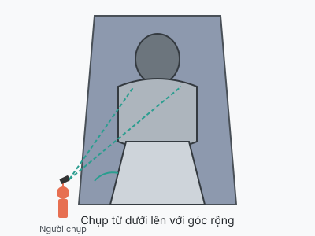
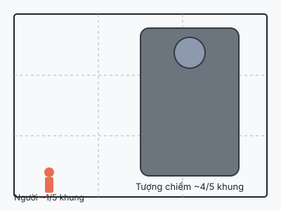

Lạc Sơn Đại Phật là tượng Phật bằng đá cao 71m, ngồi nhìn ra nơi hợp lưu của ba
con sông. Đây là một trong những tượng Phật bằng đá lớn nhất thế giới, nên chụp
sao cho thấy được độ cao và sự trang nghiêm là thử thách thú vị.

Tượng Phật khổng lồ tạo cảm giác bao la khi được đặt trong khung với cây cối hoặc người đi lại phía trước.

### 1. Chụp từ dưới lên để thể hiện độ cao

Đứng ở vị trí thấp, đưa máy lên cao hoặc dùng góc rộng (ultrawide) để bắt toàn
bộ tượng từ chân đến đầu. Tránh đứng quá gần, sẽ bị méo đầu và chân. Nếu có chân
máy hoặc tìm chỗ cao hơn một chút, hãy tận dụng.

Người đứng xa, đưa máy lên cao hoặc dùng góc rộng để bắt trọn tượng từ chân đến đầu.

### 2. Đưa người vào khung để so sánh kích thước

Tượng 71m cao khó hình dung nếu không có vật tham chiếu. Nhờ người đi cùng đứng
ở góc dưới khung, cách máy khoảng 5–10m, tượng ở phía sau. Người chiếm khoảng
1/5 khung dưới, tượng chiếm phần còn lại. Kết quả là cảm giác con người trở nên
nhỏ bé trước đại tượng.

Đặt người ở 1/5 khung dưới, tượng chiếm 4/5 còn lại — cảm giác quy mô sẽ rõ ràng.

Người nhỏ bé ở góc dưới làm vật tham chiếu, giúp người xem cảm nhận độ cao thực của tượng.

### 3. Chụp chi tiết: mặt, bàn tay, ngón chân

Đừng chỉ chụp toàn thân. Cận cảnh khuôn mặt hiền từ, bàn tay khổng lồ đặt trên
đầu gối, hay ngón chân cao bằng người lớn đều là những chi tiết gây ấn tượng mạnh.
Dùng zoom 2x–3x nếu đứng xa, hoặc chụp gần khi đi xuống chân tượng.

### 4. Tận dụng sông nước và cầu làm nền

Lạc Sơn Đại Phật quay mặt ra sông, nên nếu đi thuyền hoặc đứng ở bờ đối diện,
bạn có thể chụp cả tượng và dòng nước trong cùng khung. Thời điểm hoàng hôn hoặc
sáng sớm, ánh sáng dịu sẽ làm nổi bật màu xám của đá và màu xanh của nước.

Tượng Phật quay mặt ra sông, dùng nước và cầu làm nền để tăng chiều sâu cho ảnh.

### 5. Chọn ánh sáng và thời gian

Tượng Phật nằm lọt thỏm trong núi nên phần lớn thời gian trong bóng râm, khó có
ánh sáng rực rỡ chiếu trực tiếp. Đừng kỳ vọng hoàng hôn vàng óng trên mặt tượng.
Thay vào đó, hãy tận dụng:

- **Sương mù hoặc mây thấp**: làm nền mờ ảo, tượng đá xám nổi bật hơn.
- **Nắng xiên vào khe núi**: chỉ cần một vệt sáng nhẹ trên mặt Phật hoặc vai
  tượng cũng đủ tạo điểm nhấn.
- **HDR / chụp RAW**: giúp giữ chi tiết vùng tối ở chân tượng và vùng sáng ở
  nền trời.
- **Tránh giữa trưa**: nếu nắng lọt qua khe, bóng sẽ rất cứng và chia đôi tượng.

Tượng Phật nằm trong vách núi, dù ánh sáng không rực rỡ vẫn có thể tận dụng nền trời, cây cối hoặc sương mù để tạo khung hình ấn tượng.

Chúc bạn có những tấm ảnh Lạc Sơn Đại Phật thật ấn tượng!
