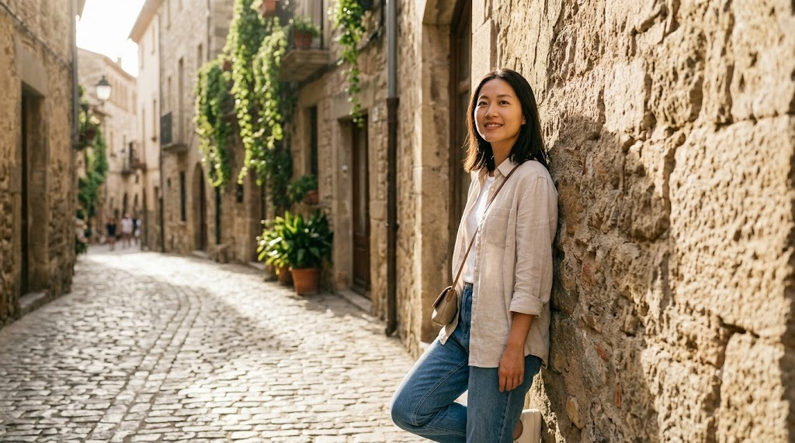

Khi đi du lịch, không phải lúc nào bạn cũng có thời gian chuẩn bị tạo dáng kỹ.
Vài tip dưới đây giúp tạo dáng tự nhiên ở hầu hết mọi địa điểm, từ phố cổ, công
viên, núi rừng đến bờ biển.

Tạo dáng tự nhiên nhờ tương tác với không gian xung quanh thay vì đứng yên nhìn máy.

### 1. Đứng nghiêng người, không đứng thẳng đơ

Đứng thẳng hai chân song song thường trông cứng đờ. Thay vào đó, đặt trọng tâm
lên một chân, chân còn lại hơi duỗi hoặc gập nhẹ. Nghiêng hông một chút, đưa một
tay lên tóc, túi hoặc tự nhiên để bên hông. Cơ thể có đường cong, ảnh sẽ mềm mại
hơn ngay.

### 2. Ngồi tự nhiên, dùng vật xung quanh

Ngồi trên bậc thang, ghế đá, lan can, bờ tường — đừng ngồi quá chỉn chu. Một
chân duỗi, một chân gập, hai tay đặt lên đầu gối hoặc tựa nhẹ vào bên cạnh. Nếu
có túi, mũ, chai nước, hãy cầm hoặc đặt bên cạnh để tạo cảm giác đang nghỉ ngơi
thật sự.

### 3. Đi lại, quay lưng, nhìn ra xa

Ảnh tĩnh đứng nhìn máy dễ gượng. Thử đi lại chậm vài bước, quay lưng về phía
máy nhìn ra cảnh, hoặc quay đầu nhìn qua vai. Nhờ người chụp bấm liên tiếp 3–5
tấm để chọn khoảnh khắc tự nhiên nhất — tóc bay, bước chân, áo xoè đều đẹp.

### 4. Dùng phụ kiện để tay không bị rỗi

Tay không biết để đâu là nguyên nhân chính khiến ảnh gượng. Mũ, kính, túi,
chai nước, khăn, bản đồ đều là đạo cụ tốt. Cầm nhẹ, đưa lên, đặt xuống, hoặc
che nắng — động tác nhỏ sẽ giúp tay tự nhiên và khuôn mặt thư giãn hơn.

### 5. Tương tác với môi trường

Chạm nhẹ vào tường gạch, cầm lan can, ngồi bệt trên thảm cỏ, nhặt lá, chỉ vào
một góc phố, hoặc cười với người đi đường. Tương tác giúp bạn quên máy ảnh và
thả lỏng, người xem cũng cảm nhận được không khí của địa điểm.

### 6. Biểu cảm khuôn mặt thả lỏng

Không cần cười toe toét. Nhìn xa, nhắm mắt hít thở, cười nhẹ, hoặc giữ vẻ mặt
trầm tư đều đẹp. Quan trọng là không căng vai và cằm. Hãy thở ra một hơi trước
khi chụp, vai hạ xuống, cằm hơi nhô nhẹ — khuôn mặt sẽ gọn và tự nhiên.

### 7. Chụp theo nhóm: xếp so le, không thẳng hàng

Nếu chụp nhóm, tránh xếp hàng ngang như chụp hộ chiếu. Xếp người so le thành
vài hàng, cao đứng sau, thấp ngồi/đứng trước, để khoảng trống xen kẽ. Mọi người
không cần cùng nhìn máy: người nói chuyện, người nhìn nhau, người nhìn cảnh —
nhóm sẽ sống động hơn.

Chúc bạn có những tấm ảnh du lịch tự nhiên và đầy cảm xúc!
