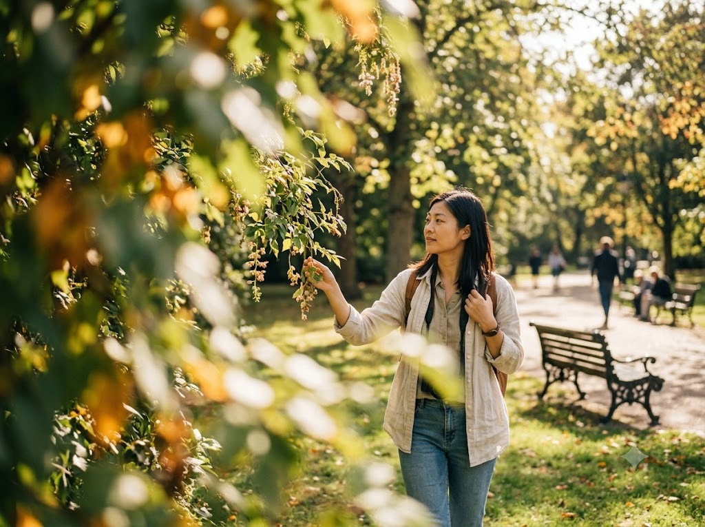
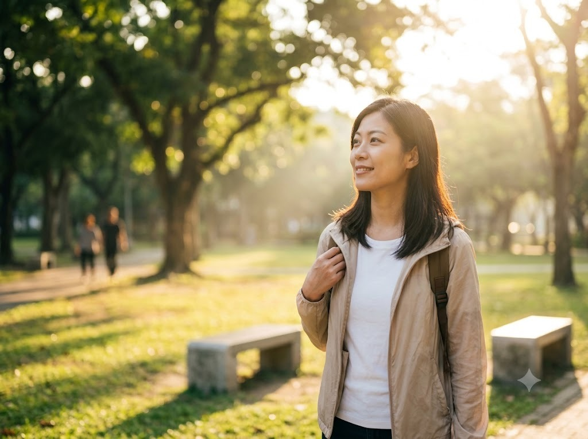
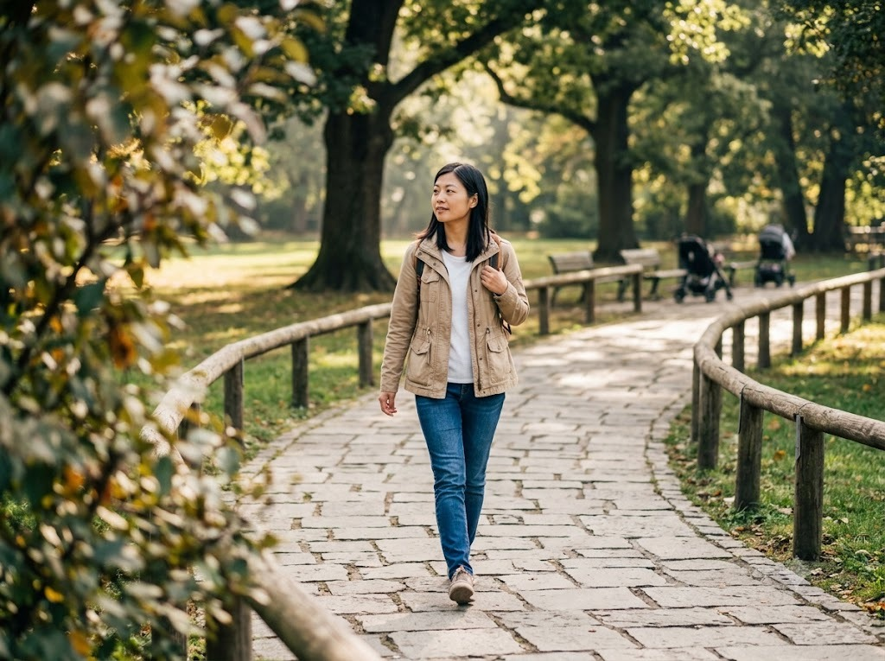
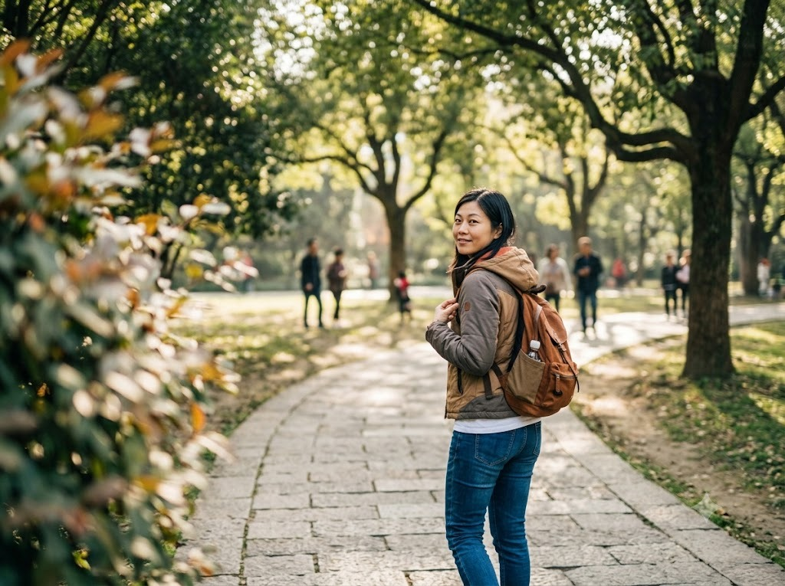
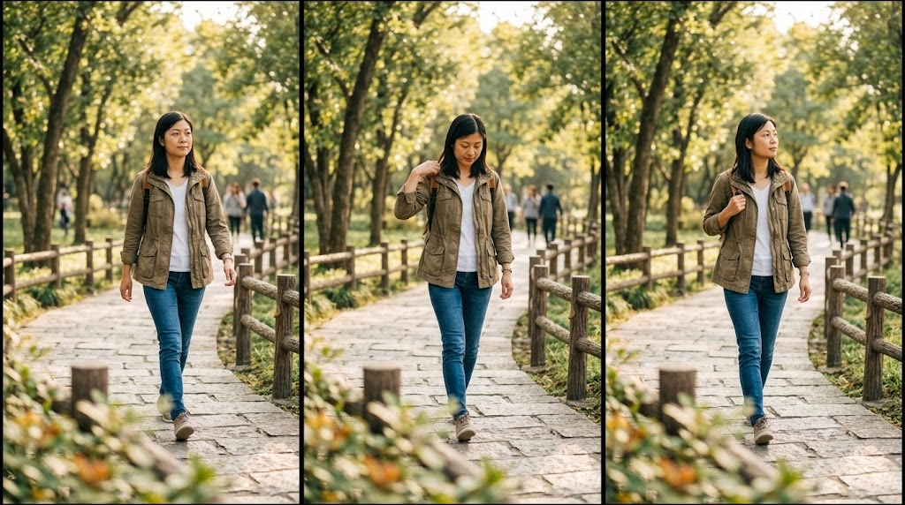
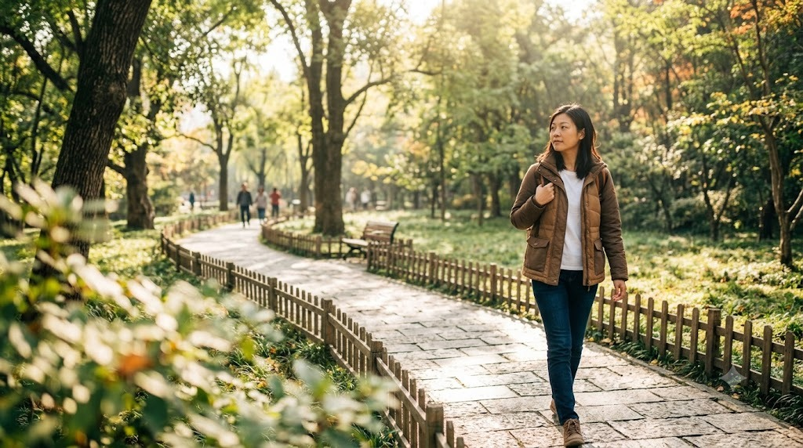

Ở phần 2, thử biến những tư thế đơn giản thành ảnh có câu chuyện hơn. Không cần
diễn xuất cầu kỳ — chỉ cần chọn đúng góc máy, khoảng cách và một hành động nhỏ.

Phần 2 tập trung vào chiều sâu, góc máy và những chuyển động nhỏ.

### 1. Để tiền cảnh che nhẹ một phần khung hình

Đứng sau tán lá, cánh cửa, lan can hoặc một góc tường rồi chụp qua khoảng
trống. Tiền cảnh làm bức ảnh có chiều sâu và giúp bạn không phải đứng giữa
không gian quá rộng.

Tán lá ở tiền cảnh che nhẹ một phần khung hình, tạo chiều sâu và làm chủ thể nổi bật hơn.

### 2. Nhìn về phía có ánh sáng

Thay vì nhìn thẳng máy, quay mặt về phía nguồn sáng dịu hoặc nhìn ra ngoài
khung hình. Cách này giúp biểu cảm tự nhiên hơn và tạo một vùng sáng đẹp trên
gương mặt.

Quay mặt về phía ánh sáng dịu giúp gương mặt sáng hơn và biểu cảm tự nhiên hơn.

### 3. Dùng đường dẫn để hướng mắt người xem

Đứng trên bậc thang, con đường, cây cầu hoặc hành lang rồi đặt cơ thể theo
đường nét của địa điểm. Một chân có thể bước nhẹ về phía trước để dáng không bị
đứng yên và khung hình có cảm giác chuyển động.

Con đường và lan can dẫn mắt người xem từ tiền cảnh đến nhân vật, tạo cảm giác có chiều sâu.

### 4. Chụp từ phía sau rồi gọi nhẹ qua vai

Quay lưng nhìn cảnh, sau đó quay đầu lại một chút khi người chụp bấm máy.
Không cần quay hẳn mặt — góc nghiêng qua vai thường tự nhiên và kể được câu
chuyện về nơi bạn đang đứng.

Một cái nhìn nhẹ qua vai giữ được cảm giác đang khám phá, thay vì tạo dáng cứng trước máy ảnh.

### 5. Tạo dáng theo ba nhịp

Đừng giữ nguyên một tư thế quá lâu. Hãy thực hiện ba động tác liên tiếp: đặt
chân, đưa tay lên phụ kiện, rồi nhìn sang một hướng khác. Người chụp bấm liên
tiếp trong cả chuỗi để bắt được khoảnh khắc mềm mại nhất.

Đặt chân, chạm nhẹ vào phụ kiện rồi nhìn sang hướng khác — ba nhịp nhỏ tạo ra nhiều khoảnh khắc tự nhiên.

### 6. Chừa khoảng thở cho khung hình

Không nhất thiết phải đứng giữa ảnh. Đặt người ở một phần ba khung và chừa
không gian về hướng mắt nhìn hoặc hướng đang bước tới. Khoảng trống làm ảnh
thoáng hơn và giúp địa điểm được kể rõ hơn.

Đặt nhân vật lệch sang một bên, chừa khoảng trống theo hướng nhìn để bức ảnh thoáng và có câu chuyện hơn.

### 7. Chụp cùng một tư thế ở nhiều góc

Sau khi có ảnh chính diện, hãy thử chụp ngang hông, thấp hơn tầm mắt hoặc lùi
ra xa để lấy cả bối cảnh. Một tư thế nhưng nhiều góc máy sẽ cho bạn cả ảnh
chân dung lẫn ảnh kể chuyện trong cùng một điểm đến.

Chúc bạn có thêm nhiều bức ảnh tự nhiên, có chiều sâu và đúng với cá tính của
mình.
