Quán cà phê, khu phố, công viên hay một góc nhỏ trong chuyến đi đều có thể trở
thành bối cảnh đẹp để chụp chân dung. Không cần tạo dáng cầu kỳ — hãy bắt đầu
với một hành động tự nhiên và để không gian kể thêm câu chuyện.

### 1. Ngồi bên cửa sổ, nhìn ra ngoài

Ngồi nghiêng người về phía cửa sổ, đặt tay cạnh ly nước hoặc chống nhẹ lên
bàn. Không cần nhìn máy; hãy nhìn ra đường hoặc nhìn vào ánh sáng để gương mặt
thư giãn hơn.

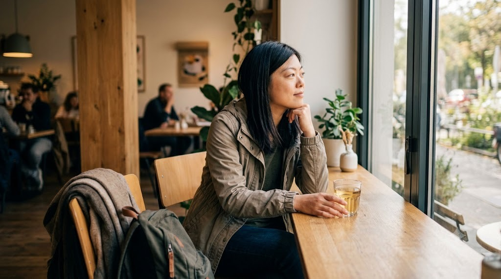

Ánh sáng từ cửa sổ làm gương mặt sáng dịu, còn ánh mắt nhìn ra ngoài giúp dáng ngồi tự nhiên.

### 2. Cầm ly nước như một đạo cụ

Ly cà phê giúp hai tay có việc để làm và tạo cảm giác bức ảnh đang ghi lại một
khoảnh khắc thật. Cầm ly nhẹ, đưa lên gần môi hoặc đặt xuống bàn thay vì nhìn
thẳng máy quá lâu.

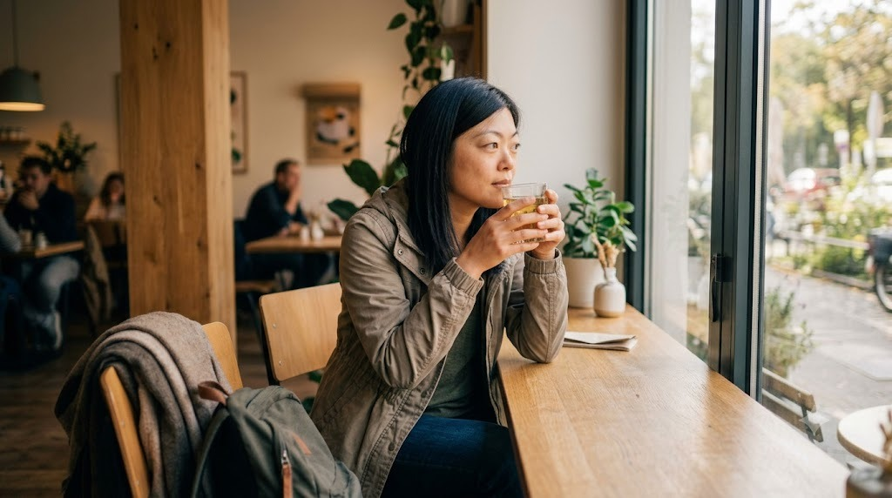

Cầm ly nhẹ gần môi, nhìn ra ngoài thay vì nhìn thẳng máy để đôi tay và biểu cảm tự nhiên hơn.

### 3. Đứng gọi đồ hoặc chờ đồ uống

Đứng cạnh quầy, xem menu, chỉnh túi hoặc nhìn về phía nhân viên. Những động tác
nhỏ này tạo dáng tự nhiên hơn việc đứng yên giữa quán.

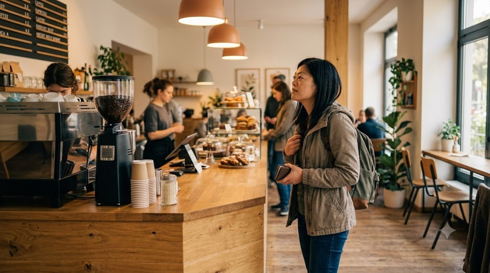

Xem menu, chỉnh túi hoặc chờ đồ uống — những khoảnh khắc đời thường giúp dáng đứng bớt gượng.

### 4. Tận dụng gương, kính và mặt bàn

Thử chụp qua gương, phản chiếu trên cửa kính hoặc đặt điện thoại thấp sát mặt
bàn. Các lớp phản chiếu giúp ảnh có chiều sâu và ghi lại được không khí của
quán.

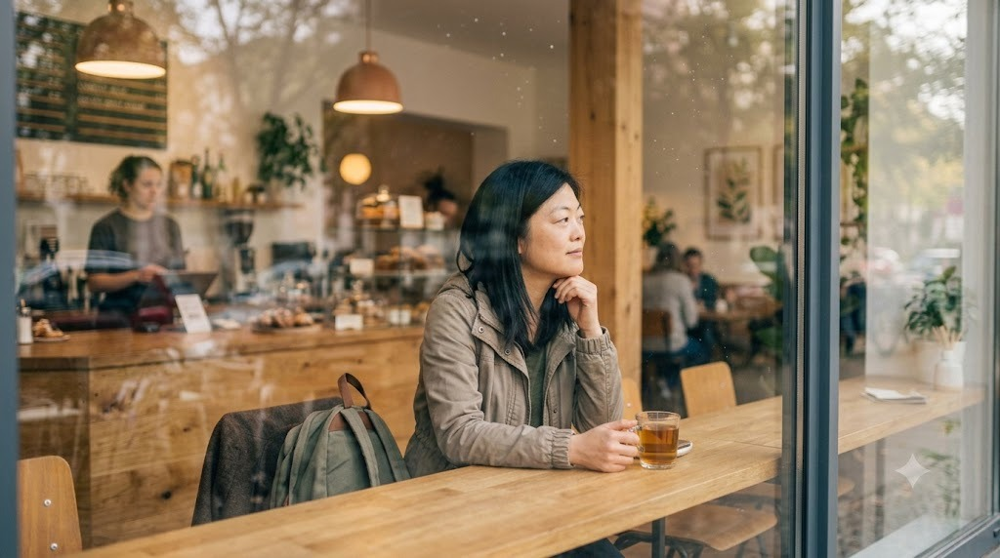

Chụp qua lớp kính hoặc mặt bàn để thêm phản chiếu, giúp bức ảnh có chiều sâu và vẫn giữ được không khí quán.

### 5. Chụp ở lối vào hoặc góc chuyển tiếp

Lối cửa, hành lang, cầu thang và ban công thường có đường dẫn đẹp. Để nhân vật
đi chậm qua khung hình, quay lưng hoặc ngoái lại qua vai để ảnh bớt cảm giác
đang sắp đặt.

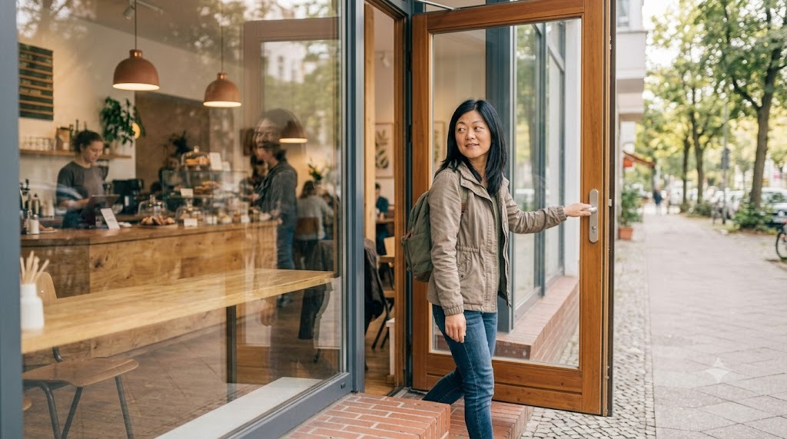

Một bước chân qua cửa, tay chạm tay nắm và ánh mắt nhìn lại giúp khoảnh khắc chuyển tiếp trông tự nhiên.

### 6. Để hậu cảnh có dấu hiệu của địa điểm

Không cần xóa sạch mọi thứ phía sau. Một chiếc máy pha cà phê, giá sách, bảng
hiệu hoặc hàng cây sẽ giúp người xem biết bạn đang ở đâu. Chỉ cần giữ hậu cảnh
gọn và không cắt ngang đầu nhân vật.

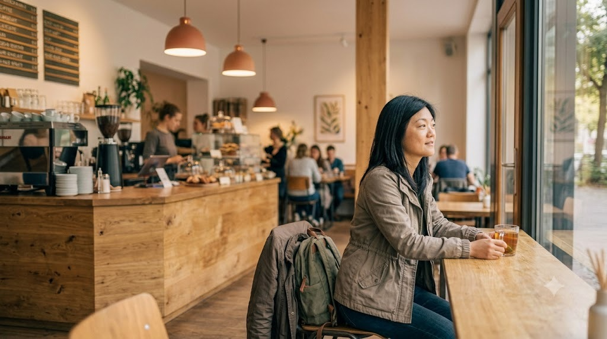

Quầy bar, máy pha cà phê và cửa sổ giúp người xem nhận ra địa điểm mà không làm nhân vật bị chìm.

### 7. Chụp một dáng, nhiều khung hình

Giữ nguyên tư thế trong vài giây rồi chụp toàn cảnh, trung cảnh và cận cảnh.
Sau đó đổi hướng nhìn hoặc thay đổi nhẹ vị trí tay. Một buổi cà phê sẽ có đủ
ảnh chân dung, ảnh kể chuyện và ảnh chi tiết.

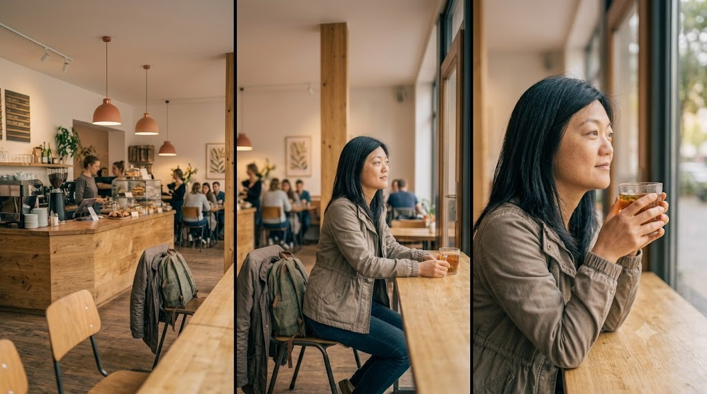

Giữ nguyên tư thế nhưng đổi khoảng cách để có một bộ ảnh đa dạng từ không gian quán đến biểu cảm gương mặt.

### 8. Chụp chân dung trước cửa quán

Cửa quán thường có bảng hiệu, khung kính và ánh sáng chuyển tiếp giữa trong
nhà với ngoài trời. Hãy đứng lệch khỏi chính giữa cửa, chạm nhẹ vào tay nắm,
nghiêng người hoặc bước ra ngoài để dáng trông tự nhiên hơn. Nếu có bảng hiệu,
để khoảng trống phía trên đầu vừa đủ để tên quán vẫn đọc được.

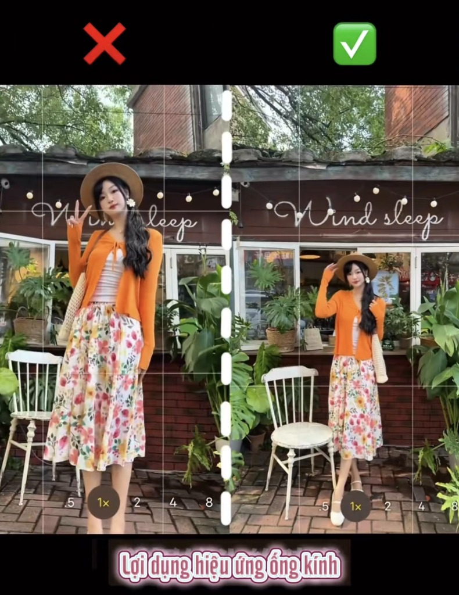

Không đứng cứng chính giữa cửa; hãy tận dụng khung cửa, bảng hiệu và khoảng trống xung quanh.

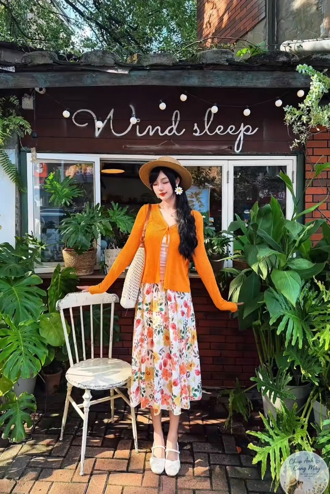

Một tay chạm cửa, tay còn lại giữ túi hoặc phụ kiện để tạo dáng bớt gượng.

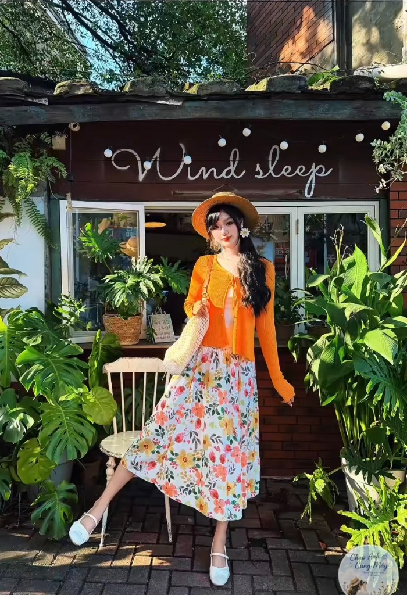

Nghiêng người và đặt một chân lên trước giúp đường nét cơ thể mềm mại hơn.

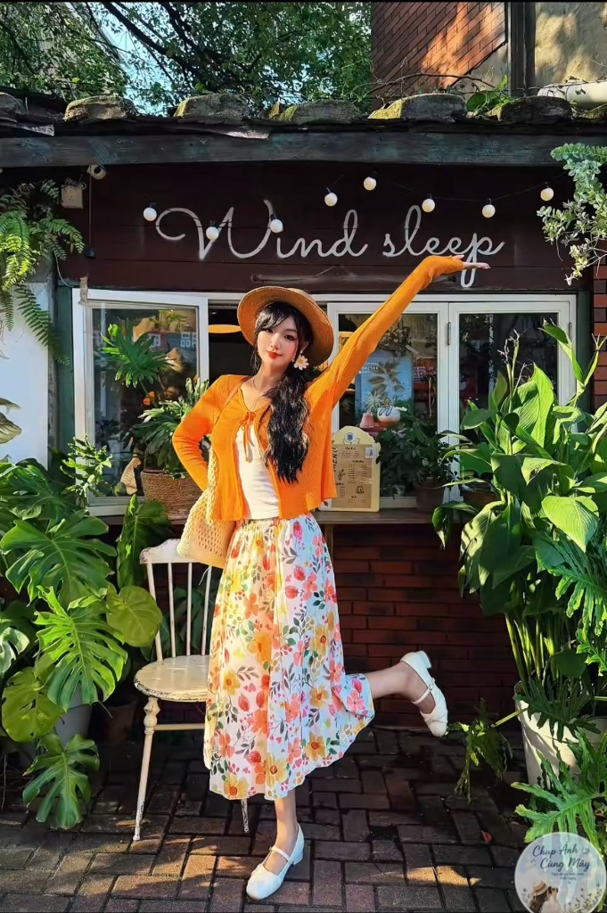

Có thể thêm một động tác vui như giơ tay hoặc nhấc nhẹ chân, nhưng vẫn giữ ánh mắt và vai thư giãn.

Trong lúc chờ, bạn có thể lưu bài vào playlist để chuẩn bị trước khi đi chụp.
