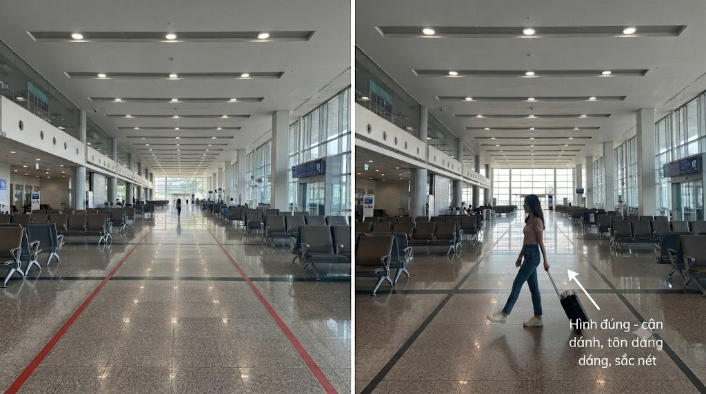
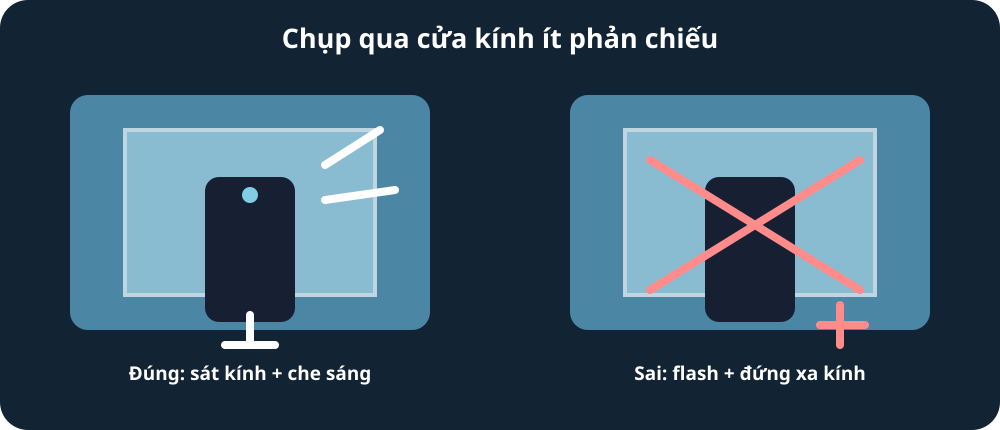
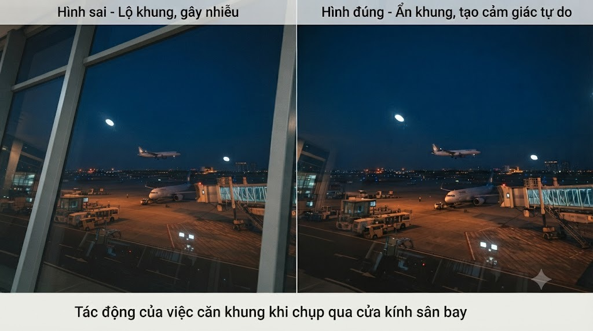
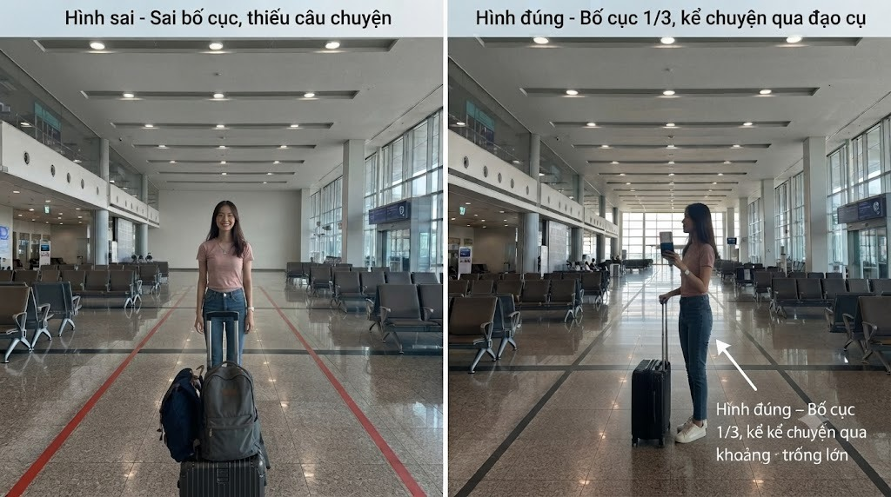
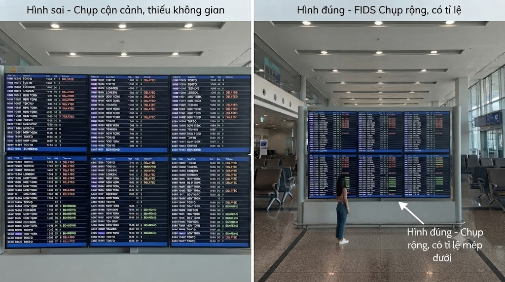
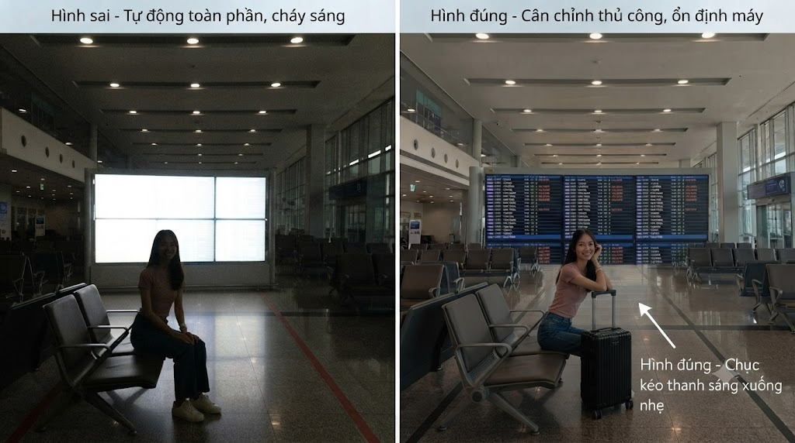
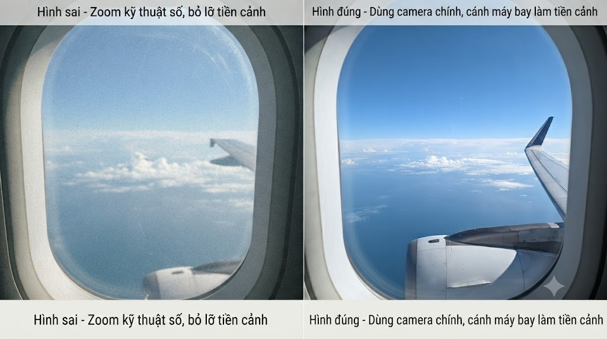

Sân bay quốc tế có rất nhiều chất liệu để chụp: cửa kính lớn, bảng chuyến bay,
hàng ghế chờ, băng chuyền hành lý và những đường dẫn kéo dài đến cổng ra máy
bay. Nhưng đây cũng là nơi cần ưu tiên lịch trình, sự riêng tư và quy định an
ninh. Một bức ảnh đẹp không đáng để bạn lỡ chuyến hoặc làm phiền người khác.

## Trước khi bấm máy: nhớ ba điều

**Kiểm tra quy định:** Không chụp trong khu vực kiểm tra an ninh, hải quan hoặc
khu vực hạn chế nếu sân bay không cho phép. Làm theo biển báo và hướng dẫn của
nhân viên.

**Che thông tin cá nhân:** Không đăng ảnh còn rõ mã đặt chỗ, mã QR, số hộ chiếu,
thẻ lên máy bay, màn hình check-in hoặc tên đầy đủ của hành khách khác. Có thể
chụp lại sau khi che thông tin, hoặc cắt phần đó trước khi chia sẻ.

**Đặt lịch trình trước ảnh:** Chụp ở sảnh, cửa kính hoặc khu chờ sau khi đã biết
cổng lên máy bay. Để điện thoại sẵn sàng nhưng đừng vừa đi vừa nhìn màn hình ở
khu đông người.

Ưu tiên sảnh công cộng, cửa kính và khu chờ được phép chụp;
tránh đưa thông tin trên thẻ lên máy bay hoặc màn hình chuyến bay vào ảnh.

### 1. Dùng các đường dẫn có sẵn trong nhà ga

Hàng ghế, lan can, vạch trên sàn, dãy đèn và trần nhà thường tạo thành các
đường dẫn rất đẹp. Đứng ở đầu hành lang hoặc giữa hai dãy ghế để các đường
thẳng chạy từ góc ảnh vào cổng máy bay, bảng thông tin hoặc nhân vật.

Đừng để đường dẫn bị cắt ngang bởi quá nhiều vật ở tiền cảnh. Hạ máy thấp một
chút, giữ điện thoại thẳng và chờ một người kéo vali đi vào đúng điểm cần nhấn.

Các vạch trên sàn, dãy đèn và hàng ghế dẫn mắt về phía
xa. Một người đang kéo vali giúp khung hình có điểm nhấn và kể được câu chuyện
đang di chuyển.

### 2. Chụp qua cửa kính mà không bị lóa

Lau nhanh mặt kính bằng khăn mềm, tắt flash và đưa ống kính gần mặt kính nhưng
không chạm mạnh. Nghiêng máy vài độ để tránh phản chiếu của đèn trần; nếu có
thể, dùng tay hoặc áo khoác che phần ánh sáng phía sau điện thoại.

Chụp máy bay qua cửa sổ thường đẹp hơn khi bầu trời có lớp mây hoặc lúc hoàng
hôn. Chạm lấy nét vào máy bay hoặc đường chân trời, rồi giảm sáng nhẹ nếu mảng
trời bị trắng.

Ống kính càng gần kính và nguồn sáng phía sau càng được che,
ảnh càng ít bóng phản chiếu.

Nếu khung cửa nằm giữa chủ thể, hãy bước sang bên hoặc
đổi góc để đường khung không cắt vào máy bay; ảnh sẽ thoáng và có cảm giác tự
do hơn.

### 3. Chụp người với bối cảnh sân bay

Cho nhân vật đứng lệch 1/3 khung hình, chừa khoảng trống về phía họ đang nhìn
hoặc hướng máy bay. Một chiếc vali, vé đã che thông tin hoặc cửa kính phía sau
là đạo cụ đủ để kể câu chuyện mà không cần tạo dáng phức tạp.

Nếu chụp người lạ, hãy tránh chụp cận mặt khi chưa được đồng ý. Với người đi
cùng, có thể nhờ họ kéo vali, xem bảng chuyến bay hoặc bước chậm qua khung hình;
chụp liên tiếp 3–5 tấm để bắt khoảnh khắc tự nhiên.

Đặt người lệch một phần ba, dùng vali làm đạo cụ và chừa
khoảng trống theo hướng di chuyển giúp ảnh có câu chuyện hơn.

### 4. Tận dụng bảng chuyến bay nhưng không biến ảnh thành ảnh chụp màn hình

Bảng điện tử có chữ và giờ bay tạo cảm giác rất “đang đi du lịch”, nhưng thông
tin thay đổi nhanh. Chụp rộng để lấy cả bảng, không cần zoom quá gần từng dòng.
Nếu muốn đăng mạng xã hội, kiểm tra lại ảnh và che mã chuyến, tên hành khách,
mã đặt chỗ hoặc thông tin cá nhân nếu chúng hiện rõ.

Có thể đợi một người đứng nhỏ dưới bảng để tạo mốc tỉ lệ. Đừng che toàn bộ bảng
bằng nhân vật; đặt người ở mép dưới hoặc một phần ba khung sẽ cân bằng hơn.

Chụp rộng hơn, để bảng nằm ở phần trên và một người nhỏ
ở mép dưới sẽ cho thấy cả quy mô nhà ga, thay vì biến ảnh thành ảnh chụp màn
hình.

### 5. Chụp đêm và ánh sáng trong nhà ga

Nhà ga thường sáng không đều: bảng quảng cáo rất sáng nhưng góc ghế lại tối.
Chạm vào mặt người hoặc chủ thể cần nét, kéo thanh sáng xuống nhẹ nếu bảng bị
cháy. Dùng camera chính 1x, tựa khuỷu tay vào vali hoặc cột, và bật Night mode
chỉ khi nhân vật có thể đứng yên.

Không dùng flash để chụp qua kính hoặc trong khu chờ đông người. Ánh sáng từ
bảng hiệu, cửa hàng và đèn trần thường tự nhiên hơn, đồng thời giữ được không
khí của sân bay.

Kéo thanh sáng xuống nhẹ, tựa máy vào vali và chọn đúng
chủ thể cần nét giúp ảnh đêm giữ được chi tiết thay vì cửa sổ bị cháy trắng.

### 6. Chụp từ cửa sổ máy bay đúng thời điểm

Nếu được phép dùng điện thoại, hãy chụp sau khi máy bay đã ổn định và làm theo
hướng dẫn của tiếp viên. Lau cửa sổ, chụp sát kính, dùng camera chính và tránh
zoom số. Cánh máy bay có thể làm tiền cảnh rất tốt; đặt nó ở góc dưới để không
che hết cảnh mây hoặc thành phố.

Tránh chụp khi máy bay đang cất/hạ cánh nếu phi hành đoàn yêu cầu cất thiết bị.
An toàn và hướng dẫn trên chuyến bay luôn quan trọng hơn bức ảnh.

Camera chính giữ được độ rõ của cảnh và cánh máy bay tạo
tiền cảnh tự nhiên. Hãy đặt cánh ở góc dưới thay vì zoom sát vào một chi tiết.

### 7. Giữ nhịp chụp nhanh để không lỡ chuyến

Sân bay là nơi không nên dựng chân máy hoặc đứng lâu chắn lối đi. Chuẩn bị
camera trước, chụp 2–3 tấm rồi di chuyển sang bên. Nếu muốn ảnh có người đi qua,
đứng sát mép khu vực cho phép và không cản dòng hành khách.

## Quy trình 30 giây

1. Xác định mình đang ở khu vực công cộng và được phép chụp.
2. Kiểm tra cổng, giờ lên máy bay và lối di chuyển trước khi tìm góc.
3. Lau ống kính, tắt flash, chọn camera chính 1x.
4. Chọn một đường dẫn hoặc nguồn sáng làm điểm nhấn.
5. Chạm lấy nét, giảm sáng nhẹ nếu bảng đèn/cửa kính bị cháy.
6. Chụp vài tấm, kiểm tra thông tin riêng tư trước khi chia sẻ.

## Lỗi thường gặp và cách sửa

| Hiện tượng | Nguyên nhân | Cách sửa |
| --- | --- | --- |
| Ảnh cửa kính có bóng người/đèn | Flash hoặc ánh sáng phía sau phản vào kính | Tắt flash, che sáng, đưa máy sát kính |
| Người bị mờ | Nhà ga tối, tốc độ chụp chậm | Tìm vùng sáng hơn, tựa máy, chụp liên tiếp |
| Ảnh có thông tin nhạy cảm | Vé, mã QR hoặc bảng điện tử hiện rõ | Cắt ảnh hoặc làm mờ trước khi đăng |
| Ảnh lộn xộn | Chụp giữa dòng người, quá nhiều bảng hiệu | Đổi góc, chờ một khoảng trống, dùng đường dẫn |
| Lỡ chuyến vì mải chụp | Không kiểm tra thời gian và cổng | Chụp nhanh, đặt báo thức, ưu tiên lịch trình |

Sân bay đẹp nhất khi ảnh còn giữ được cảm giác chuyển tiếp: người đang đi,
vali đang lăn, ánh sáng đang đổi và một cánh cửa đang mở ra chuyến đi mới. Hãy
chụp gọn, tôn trọng không gian chung và luôn để ý chuyến bay của mình trước.
