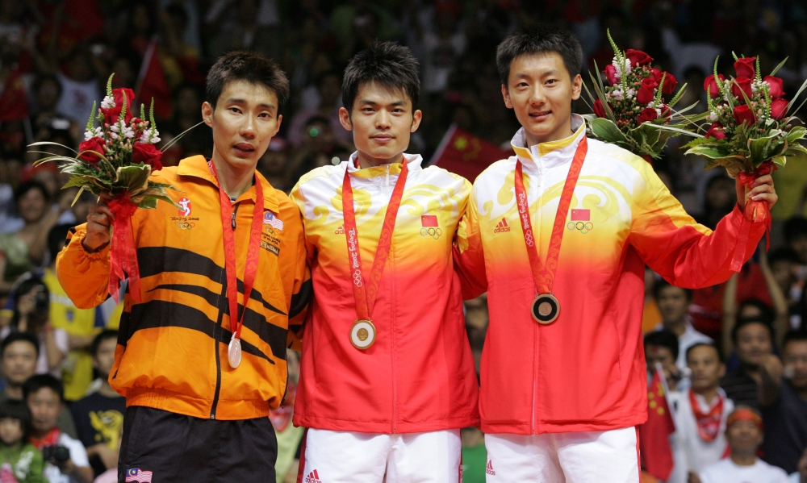
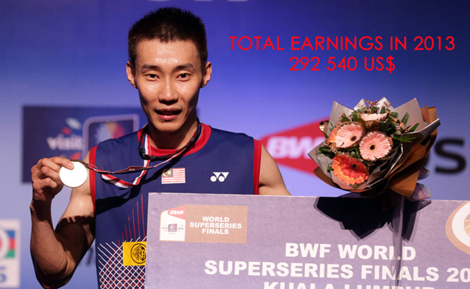

## Tiểu sử

Lee Chong Wei sinh năm 1982 tại bang Penang, Malaysia, trong một gia đình gốc
Hoa bình thường. Anh được phát hiện tài năng năm 17 tuổi và vào học viện thể
thao quốc gia Bukit Jalil — khởi đầu muộn so với nhiều tay vợt cùng thế hệ.

Không có tấm vàng Olympic hay danh hiệu thế giới nào, nhưng Lee Chong Wei vẫn
được xem là một trong những tay vợt vĩ đại nhất nhờ sự bền bỉ phi thường:
**349 tuần giữ ngôi số 1 thế giới** — kỷ lục của đơn nam.

## Phong cách thi đấu

- Tốc độ chân nổi tiếng — được mệnh danh có bước chân nhanh nhất cầu lông.
- Phản công cực hay, đỡ đập chéo rất khó chịu.
- Lối chơi toàn diện, ít điểm yếu.

## Thành tích & danh hiệu chính

- **HCB Olympic**: 3 lần liên tiếp (Bắc Kinh 2008, London 2012, Rio 2016) —
  đều thua ở chung kết, 2 lần trước Lin Dan.
- **Vô địch All England**: 4 lần.
- 69 danh hiệu trong sự nghiệp; từng giữ kỷ lục 199 tuần liên tiếp đứng số 1
  thế giới.
- Cùng Malaysia đoạt HCĐ Thomas Cup 2014.

<figure class="fig-left">
  
  <figcaption>Lee Chong Wei trên bục trao huy chương Olympic Bắc Kinh 2008 — ảnh: BWF</figcaption>
</figure>

<figure class="fig-right">
  
  <figcaption>Lee Chong Wei thi đấu tại French Open 2013 — ảnh: thethao247</figcaption>
</figure>

## Biệt danh

"**Datuk**" — tước hiệu nhà nước Malaysia phong tặng vì công lao với thể
thao nước nhà; cả Malaysia quen gọi anh là "Datuk Lee".

## Giai thoại

Năm 2014 anh bị cấm thi đấu 8 tháng do nghi vấn doping (sau được minh oan là
vô ý). Năm 2018 phát hiện ung thư mũi giai đoạn đầu, phải giải nghệ năm 2019.
Cuộc đời anh được đưa lên phim điện ảnh *Lee Chong Wei* (2018). Đối đầu Lin
Dan hơn 40 lần là cặp kình địch vĩ đại nhất môn cầu lông.

## Video

  <iframe src="https://www.youtube.com/embed/a64pWiUtgJQ" title="Lee Chong Wei vs Lin Dan — chung kết World Championships 2013" loading="lazy" allow="accelerometer; autoplay; clipboard-write; encrypted-media; gyroscope; picture-in-picture" allowfullscreen></iframe>

*Nguồn tham khảo: BWF, Wikipedia.*
