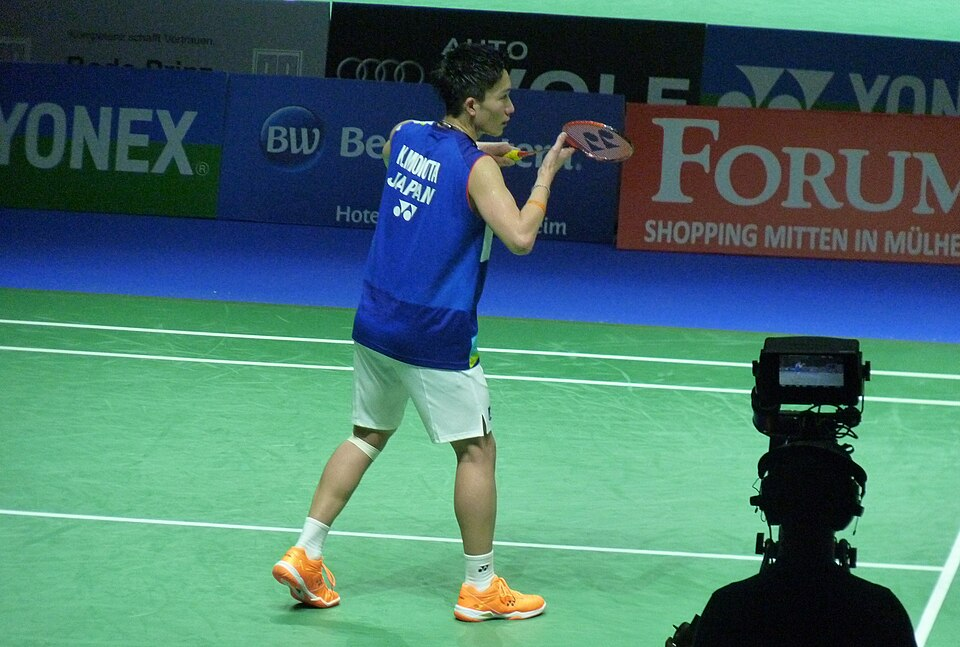
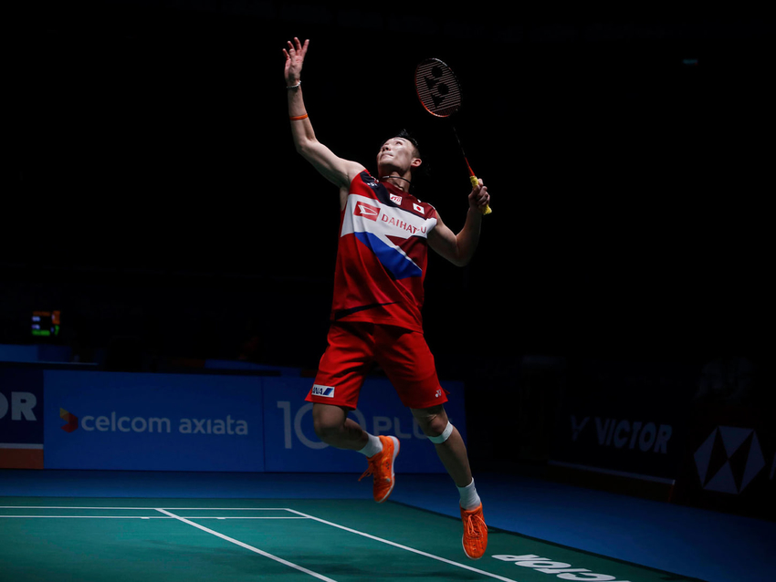

## Tiểu sử

Kento Momota sinh năm 1994 tại tỉnh Kagawa, Nhật Bản, được xem là thiên tài
hiếm có của cầu lông Nhật từ khi còn trẻ. Sự nghiệp anh trải qua những cú
rơi ngoạn mục: bị đình chỉ vô thời hạn năm 2016 vì scandal đánh bạc trái
phép, trở lại leo thẳng lên số 1 thế giới, rồi gặp tai nạn giao thông nghiêm
trọng năm 2020 ngay trước thềm Olympic trên sân nhà.

Dù vậy, mùa giải 2019 của Momota vẫn được xem là một trong những mùa vĩ đại
nhất: **11 danh hiệu trong một năm** — kỷ lục Guinness.

## Phong cách thi đấu

- Tay trái, lối chơi "toàn diện đến nhàm chán": thủ chắc, điều cầu chính xác
  từng centimet.
- Điểm rơi hóc hiểm + bền bỉ đeo đuổi đối thủ tới sai lầm.
- Phản công ngay trong khi thủ — đặc sản cú rê cầu sát lưới.

## Thành tích & danh hiệu chính

- **Vô địch thế giới**: 2018, 2019.
- **11 danh hiệu World Tour mùa 2019** — kỷ lục thế giới Guinness.
- Hơn 100 tuần đứng số 1 BWF; vô địch All England chưa có nhưng sở hữu gần
  như mọi giải lớn khác của hệ thống World Tour.

<figure class="fig-left">
  
  <figcaption>Kento Momota thi đấu — ảnh: Wikimedia Commons</figcaption>
</figure>

<figure class="fig-right">
  
  <figcaption>Momota với pha rê cầu sát lưới đặc trưng — ảnh: Wikimedia Commons</figcaption>
</figure>

## Biệt danh

Truyền thông châu Á gọi anh là "**tay vợt bất khả chiến bại**" trong giai
đoạn đỉnh phong 2018–2019 khi thắng gần như mọi đối thủ top đầu.

## Giai thoại

Tháng 1/2020, chiếc xe chở Momota đến sân bay Kuala Lumpur gặp tai nạn, tài
xế tử vong còn anh chấn thương mắt — chấn thương ảnh hưởng thị lực và được
cho là nguyên nhân khiến phong độ anh không còn như xưa. Năm 2024 anh rời
đội tuyển quốc gia Nhật Bản sau hơn một thập kỷ cống hiến.

## Video

  <iframe src="https://www.youtube.com/embed/boQC4J4E1ZQ" title="Kento Momota vs Viktor Axelsen — chung kết BWF 2020" loading="lazy" allow="accelerometer; autoplay; clipboard-write; encrypted-media; gyroscope; picture-in-picture" allowfullscreen></iframe>

*Nguồn tham khảo: BWF, Wikipedia.*
