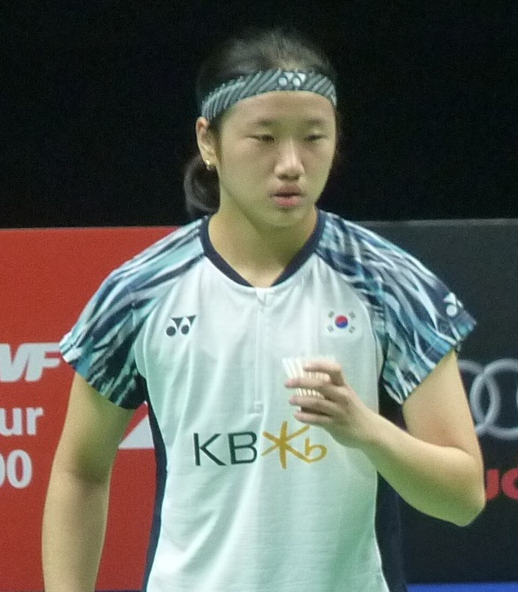
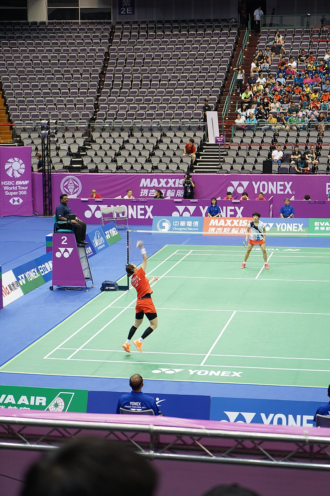

## Tiểu sử

An Se-young sinh năm 2002 tại Gwangju, Hàn Quốc. Cô nổi lên sớm như một
hiện tượng: năm 17 tuổi đã đoạt danh hiệu World Tour đầu tiên và được bầu là
VĐV triển vọng nhất của BWF (Most Promising Player 2019).

Chỉ vài năm sau, cô trở thành tâm của thế hệ mới đơn nữ — kế thừa truyền
thống cầu lông Hàn Quốc và mở ra vương triều riêng.

## Phong cách thi đấu

- Phòng thủ "bức tường di động": đỡ mọi cú đập, chân cực chắc.
- Tốc độ sân đỉnh + lối chơi kiên nhẫn ép đối thủ tự sai.
- Ngày càng bổ sung tấn công — thời kỳ gần đây gần như không có điểm yếu.

## Thành tích & danh hiệu chính

- **Vàng Olympic** Paris 2024 — HCV Olympic đầu tiên của cầu lông Hàn Quốc
  sau gần 3 thập kỷ ở nội dung đơn.
- **Vô địch thế giới** 2023 — tay vợt trẻ nhất Hàn Quốc đoạt danh hiệu này.
- **Vô địch All England** 2023 và hàng loạt danh hiệu World Tour 1000/750.
- Giữ ngôi số 1 BWF suốt thời gian dài từ 2023.

<figure class="fig-left">
  
  <figcaption>An Se-young trên sân đấu — ảnh: Wikimedia Commons</figcaption>
</figure>

<figure class="fig-right">
  
  <figcaption>An Se-young tại Chinese Taipei Open 2019 — ảnh: Wikimedia Commons</figcaption>
</figure>

## Biệt danh

Truyền thông Hàn gọi cô là "**thần đồng cầu lông**" (badminton genius) từ
khi mới 15 tuổi; fan quốc tế gọi đùa lối thủ của cô là "bức tường An".

## Giai thoại

Sau tấm vàng Olympic, An Se-young từng công khai bất đồng với cách quản lý
của hiệp hội cầu lông Hàn Quốc — sự việc gây chấn động thể thao nước này và
dẫn tới những cải cách về điều kiện tập luyện, chấn thương cho VĐV. Cô cũng
nổi tiếng với nụ cười và cú cảm ơn khán giả sau mỗi trận.

## Video

  <iframe src="https://www.youtube.com/embed/49OglwaWp_Y" title="An Se-young vs Akane Yamaguchi — chung kết thế giới" loading="lazy" allow="accelerometer; autoplay; clipboard-write; encrypted-media; gyroscope; picture-in-picture" allowfullscreen></iframe>

*Nguồn tham khảo: BWF, Wikipedia.*
