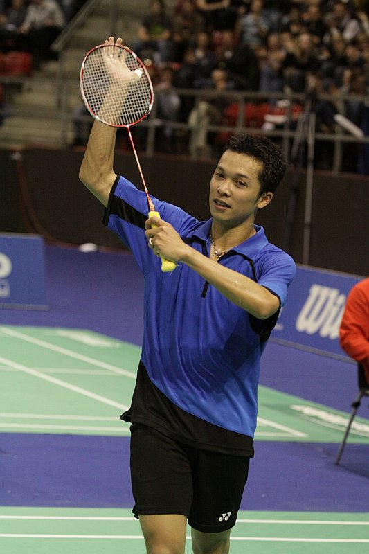

## Tiểu sử

Taufik Hidayat sinh năm 1981 tại Bandung, Indonesia, lớn lên trong lò đào tạo cầu lông huyền thoại của Indonesia. Anh là biểu tượng của thế hệ vàng cầu lông xứ vạn đảo đầu những năm 2000.

## Phong cách thi đấu

- Cú backhand được xem là đẹp nhất lịch sử — mạnh, gọn và chuẩn xác như đòn forehand.
- Kỹ thuật lưới tinh tế, điều cầu biến hóa khó đoán.
- Lối chơi nghệ sĩ: ít chạy sân, thắng bằng tay và đầu.

## Thành tích & danh hiệu chính

- **Vàng Olympic** Athens 2004.
- **Vô địch thế giới** 2005 (Mỹ).
- **HCB Olympic** — nhiều lần vô địch Asian Games, All England 2 lần vào chung kết.
- Cùng Indonesia nhiều lần đoạt Thomas Cup.

<figure>
  
  <figcaption>Taufik Hidayat với cú backhand huyền thoại — ảnh: Wikimedia Commons</figcaption>
</figure>

## Biệt danh

"Ông hoàng backhand"

## Giai thoại

Trận chung kết Olympic 2004 thắng Shon Seung-mo giúp Taufik trở thành anh hùng quốc gia Indonesia. Anh từng khai "tôi sinh ra để chơi cầu lông" — và đúng vậy, cú backhand của anh được giảng dạy trong các giáo trình đào tạo tới tận bây giờ.

*Nguồn tham khảo: BWF, Wikipedia.*
