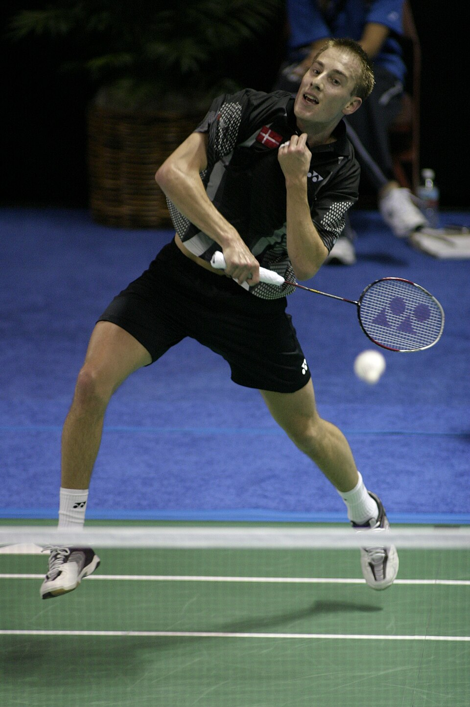

## Tiểu sử

Peter Gade sinh năm 1976 tại Aalborg, Đan Mạch, là tay vợt châu Âu xuất sắc nhất cuối thập niên 90 - đầu 2000. Anh là người mở đường cho truyền thống cầu lông đơn nam Đan Mạch mà sau này Axelsen tiếp nối.

## Phong cách thi đấu

- Nổi tiếng với cú 'double action' — vẫy vợt lừa hai nhịp khiến đối thủ xuất phát sai hướng.
- Kỹ thuật tay mềm, lối chơi đa dạng, được coi là 'nghệ sĩ' trên sân.
- Tư duy sân đọc trận cực nhanh.

## Thành tích & danh hiệu chính

- Số 1 thế giới nhiều năm liền (cuối 90 - đầu 2000).
- **Vô địch All England** 1999.
- 5 lần vô địch châu Âu.
- Top 4 Olympic Sydney 2000; 4 lần dự Olympic.

<figure>
  
  <figcaption>Peter Gade — 'phù thủy' của cầu lông châu Âu — ảnh: Wikimedia Commons</figcaption>
</figure>

## Biệt danh

"The Wizard"

## Giai thoại

Cú đánh 'double action' của Gade kinh điển tới mức BWF từng phải bàn về tính hợp lệ của nó. Sau giải nghệ 2012 anh trở thành quản lý cấp cao của Liên đoàn cầu lông Pháp, rồi huấn luyện truyền cảm hứng cho thế hệ sau.

*Nguồn tham khảo: BWF, Wikipedia.*
