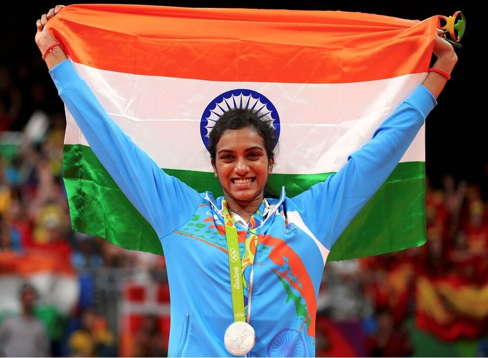

## Tiểu sử

Pusarla Venkata Sindhu sinh năm 1995 tại Hyderabad, Ấn Độ, con gái hai cựu VĐV bóng chuyền quốc gia. Cô là VĐV cầu lông thành công nhất lịch sử Ấn Độ và gương mặt thể thao nữ nổi tiếng nhất nước này.

## Phong cách thi đấu

- Tầm cao 1m80: đập cầu góc cao, bao sân rộng.
- Lối chơi sức mạnh, áp đảo ở thế trên lưới.
- Bền bỉ thể lực — chuyên thắng các trận 3 set dài.

## Thành tích & danh hiệu chính

- **HCB Olympic** Rio 2016, **HCĐ** Tokyo 2020.
- **Vô địch thế giới** 2019 — người Ấn Độ đầu tiên vô địch thế giới cầu lông.
- Nhiều HCB/HCĐ World Championships; vàng Commonwealth Games 2022.

<figure>
  
  <figcaption>PV Sindhu với tấm HCB Olympic Rio 2016 — ảnh: Wikimedia Commons</figcaption>
</figure>

## Biệt danh

"PV Sindhu"

## Giai thoại

Mùa Olympic Rio 2016, trận chung kết Sindhu - Carolina Marín trở thành một trong những sự kiện thể thao được xem nhiều nhất Ấn Độ. Cô từng trong top VĐV nữ thu nhập cao nhất thế giới theo Forbes.

*Nguồn tham khảo: BWF, Wikipedia.*
