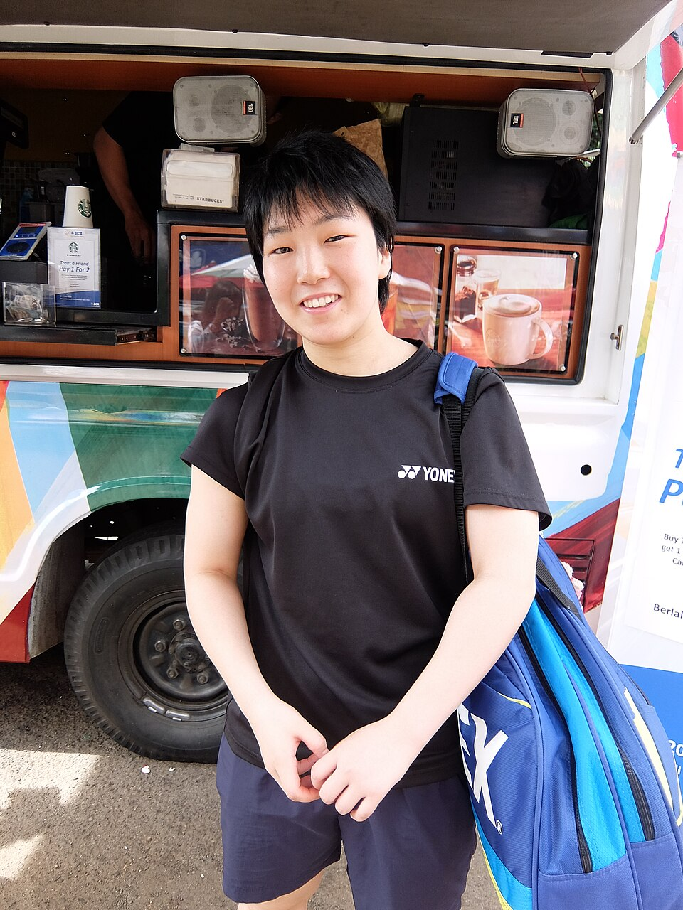

## Tiểu sử

Akane Yamaguchi sinh năm 1997 tại tỉnh Kumamoto, Nhật Bản. Chỉ cao 1m56 — thấp nhất nhóm đỉnh đơn nữ — cô bù đắp bằng tốc độ và khả năng cứu bóng phi thường, 2 lần liên tiếp vô địch thế giới 2021 và 2022.

## Phong cách thi đấu

- Bước chân nhanh nhất đơn nữ — 'roadrunner' chạy không ngừng.
- Thủ cực dai, biến mọi cú mạnh thành phản công.
- Đánh nhịp cao liên tục, ép đối thủ cạn sức.

## Thành tích & danh hiệu chính

- **Vô địch thế giới**: 2021, 2022 (liên tiếp).
- **Vô địch All England** 2022 và nhiều danh hiệu World Tour.
- Số 1 thế giới nhiều tuần; trụ cột đội Uber Cup Nhật Bản.

<figure>
  
  <figcaption>Akane Yamaguchi thi đấu — ảnh: Wikimedia Commons</figcaption>
</figure>

## Biệt danh

"The Roadrunner"

## Giai thoại

Chứng kiến Yamaguchi đuổi bóng tới tận góc sân rồi phản công ngay lập tức là hình ảnh quen thuộc nhất cầu lông hiện đại — cô chứng minh chiều cao không phải tất cả trong cầu lông.

*Nguồn tham khảo: BWF, Wikipedia.*
