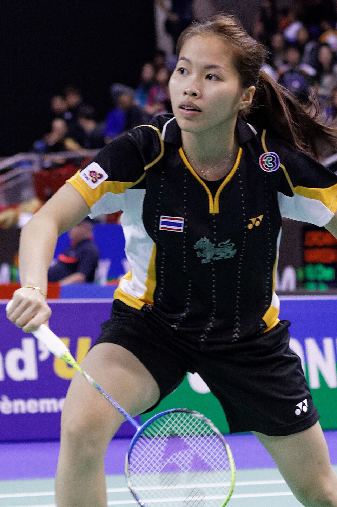

## Tiểu sử

Ratchanok Intanon sinh năm 1995 tại Yasothon, Thái Lan, trong gia đình nghèo — bố mẹ làm công tại nhà máy sản xuất mì và cô tập cầu lông ngay trong khuôn viên đó. Năm 18 tuổi cô vô địch thế giới 2013, trở thành nhà vô địch trẻ nhất lịch sử đơn cầu lông.

## Phong cách thi đấu

- Kỹ thuật tay cực mềm, điều cầu tinh tế đậm chất nghệ thuật.
- Lối chơi khéo léo, ít dùng sức — thắng bằng độ 'lừa' và cảm giác bóng.
- Biến hóa nhịp đánh làm đối thủ luôn trễ một bước.

## Thành tích & danh hiệu chính

- **Vô địch thế giới** 2013 — trẻ nhất lịch sử (18 tuổi).
- 3 lần vô địch trẻ thế giới liên tiếp (2009-2011).
- Số 1 thế giới 2016; nhiều danh hiệu Superseries/World Tour.
- Nhiều HCV SEA Games cùng đội tuyển Thái Lan.

<figure>
  
  <figcaption>Ratchanok Intanon tại French Open 2013 — ảnh: Wikimedia Commons</figcaption>
</figure>

## Biệt danh

"May"

## Giai thoại

Câu chuyện từ con gái công nhân nhà máy mì thành nhà vô địch thế giới làm May trở thành anh hùng thể thao Thái Lan — cô là VĐV được yêu mến nhất xứ chùa vàng.

*Nguồn tham khảo: BWF, Wikipedia.*
