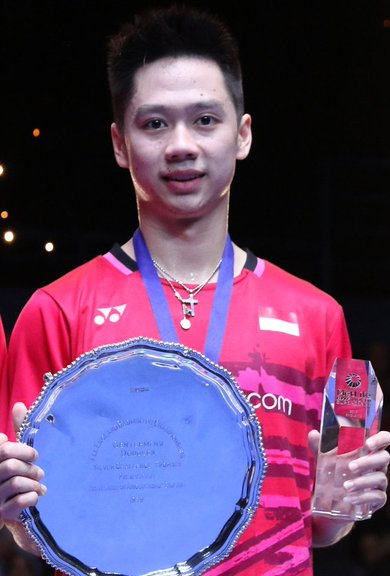

## Tiểu sử

Kevin Sanjaya Sukamuljo sinh năm 1995 tại Banyuwangi, Indonesia. Cùng Marcus Fernaldi Gideon, anh tạo nên cặp 'Minions' — cặp đôi nam thống trị đầu thập niên 2020 với số tuần số 1 thế giới kỷ lục.

## Phong cách thi đấu

- Tốc độ tay và phản xạ lưới nhanh nhất đôi nam thế giới.
- Chuyên những cú đánh 'không tưởng' — trick shot đằng sau lưng, lừa cổ tay.
- Phối hợp với Gideon thành guồng tấn công đôi tốc độ cao.

## Thành tích & danh hiệu chính

- Số 1 thế giới đôi nam nhiều năm liền cùng Gideon (kỷ lục ~226 tuần).
- **Vô địch All England** 2 lần (2017, 2018).
- Hơn 30 danh hiệu Superseries/World Tour — cặp đôi ăn khách nhất thập niên.
- Vàng Asian Games 2018, HCĐ thế giới 2022.

<figure>
  
  <figcaption>Sukamuljo đoạt All England 2017 cùng Gideon — ảnh: Wikimedia Commons</figcaption>
</figure>

## Biệt danh

"Minions"

## Giai thoại

Clip những pha đánh sau lưng và trick shot của Sukamuljo là nội dung cầu lông 'viral' nhất mạng xã hội — nhiều người không chơi cầu lông cũng biết mặt anh.

*Nguồn tham khảo: BWF, Wikipedia.*
