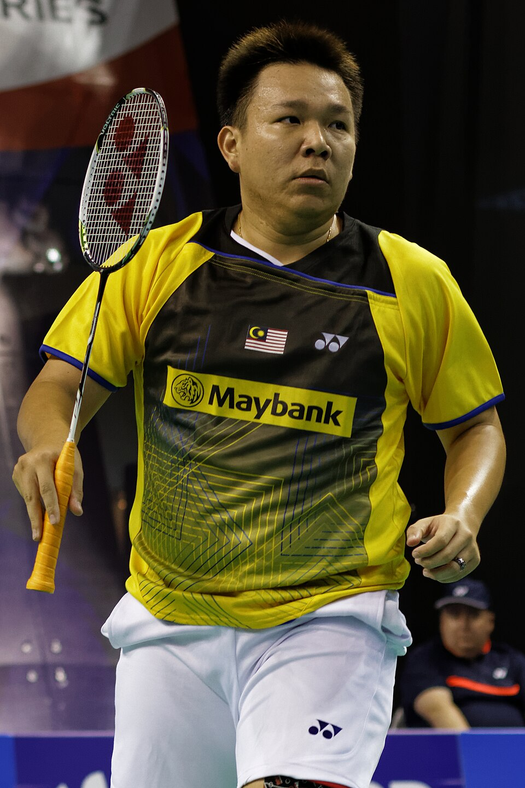

## Tiểu sử

Lee Yong-dae sinh năm 1988 tại Hwasun, Hàn Quốc, được xem là tay vợt đánh đôi tài năng nhất lịch sử Hàn Quốc — vô địch Olympic đôi nam nữ năm mới 20 tuổi và duy trì đỉnh cao hơn 15 năm ở cả hai nội dung.

## Phong cách thi đấu

- Quán quân 'đọc trận': phán đoán đường cầu của đối thủ trước cả khi họ đánh.
- Kỹ thuật phòng thủ biến tướng, đẩy cầu chuyển tấn công mượt mà.
- Đánh được cả đôi nam lẫn đôi nam nữ ở trình độ vô địch thế giới.

## Thành tích & danh hiệu chính

- **Vàng Olympic** Bắc Kinh 2008 (đôi nam nữ, cùng Lee Hyo-jung).
- **HCĐ Olympic** London 2012 (đôi nam, cùng Jung Jae-sung).
- Nhiều lần vô địch All England, hơn 40 danh hiệu Superseries.
- Số 1 thế giới cả đôi nam và đôi nam nữ.

<figure>
  
  <figcaption>Lee Yong-dae thi đấu đôi nam tại French Open 2013 — ảnh: Wikimedia Commons</figcaption>
</figure>

## Biệt danh

"LYD"

## Giai thoại

Ở tuổi 20 anh đã đứng trên đỉnh Olympic. Sự nghiệp dài 15+ năm với nhiều đồng đội khác nhau — ai chơi cùng LYD đều thành cặp đôi đáng gờm — cho thấy 'thiên tài phối hợp' có thật.

*Nguồn tham khảo: BWF, Wikipedia.*
