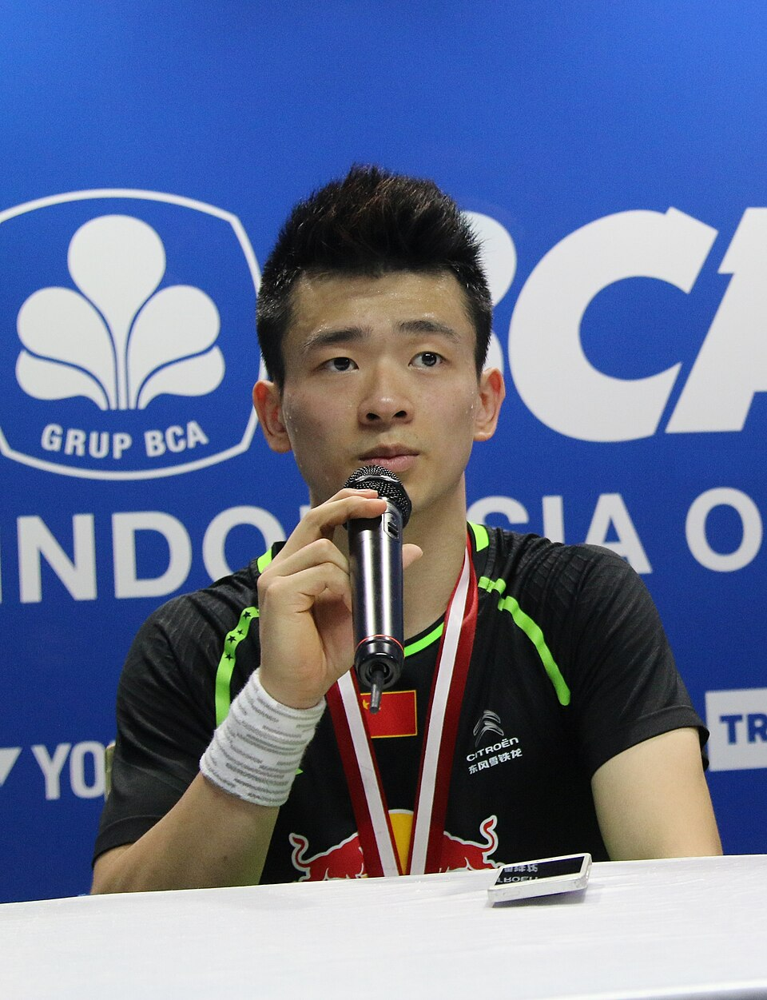

## Tiểu sử

Zheng Siwei sinh năm 1997 tại Ôn Châu, Trung Quốc. Cùng Huang Yaqiong anh tạo ra cặp đôi nam nữ được gọi 'IELTS' — gần như vô địch mọi giải lớn cuối thập niên 2010 - đầu 2020 và là cặp đôi nam nữ vĩ đại nhất lịch sử.

## Phong cách thi đấu

- Tốc độ bùng nổ + sức đập hiếm có ở đôi nam nữ.
- Phủ lưới và chuyển đổi thế trận nhanh nhất thế giới cùng Yaqiong.
- Lãnh đạo nhịp trận đấu — 'bộ não' của cặp IELTS.

## Thành tích & danh hiệu chính

- **Vàng Olympic** Paris 2024 (đôi nam nữ).
- **Vô địch thế giới**: 2018, 2019, 2022.
- HCB Olympic Tokyo 2020; 2 lần vô địch All England.
- Số 1 thế giới kỷ lục dài cùng Huang Yaqiong.

<figure>
  
  <figcaption>Zheng Siwei tại Indonesia Open 2017 — ảnh: Wikimedia Commons</figcaption>
</figure>

## Biệt danh

"IELTS (cùng Huang Yaqiong)"

## Giai thoại

Sau thất bại cay đắng chung kết Tokyo 2020, cặp IELTS tái hợp và thắng gần như tuyệt đối để khép lại bằng vàng Paris 2024 — câu chuyện 'không bỏ cuộc' đẹp nhất cầu lông hiện đại.

*Nguồn tham khảo: BWF, Wikipedia.*
