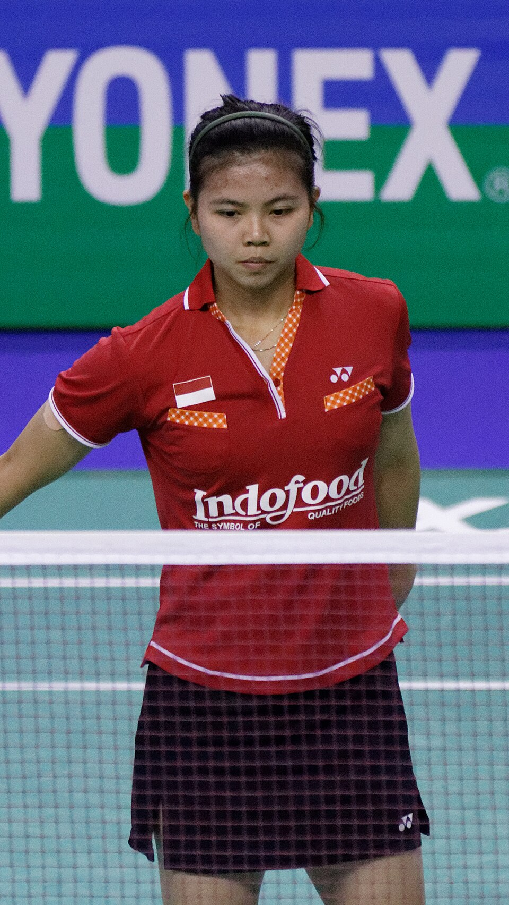

## Tiểu sử

Greysia Polii sinh năm 1987 tại Jakarta, Indonesia, là trụ cột đôi nữ Indonesia suốt gần hai thập kỷ. Ở tuổi 33 — khi nhiều người đã giải nghệ — cô cùng Apriyani Rahayu đoạt vàng Olympic Tokyo 2020, tấm vàng đôi nữ đầu tiên cho Indonesia.

## Phong cách thi đấu

- Kinh nghiệm đọc trận và bố trí đội hình bậc thầy.
- Điều phối nhịp chậm - nhanh làm đối thủ mất guồng.
- Tinh thần đội trưởng: luôn là người đỡ đần đồng đội trẻ.

## Thành tích & danh hiệu chính

- **Vàng Olympic** Tokyo 2020 (đôi nữ, cùng Apriyani Rahayu).
- Nhiều lần đứng số 1 thế giới đôi nữ.
- Vô địch Asian Games, nhiều danh hiệu Superseries suốt 15+ năm.
- 3 lần dự Olympic.

<figure>
  
  <figcaption>Greysia Polii thi đấu đôi nữ — ảnh: Wikimedia Commons</figcaption>
</figure>

## Biệt danh

"Greysia"

## Giai thoại

Trận chung kết Tokyo 2020 thắng cặp Trung Quốc và khoảnh khắc Greysia khóc nức nở trên bục vàng ở tuổi 33 là khoảnh khắc cảm động nhất cầu lông Olympic hiện đại. Chị giải nghệ năm 2021 ở đỉnh vinh quang.

*Nguồn tham khảo: BWF, Wikipedia.*
