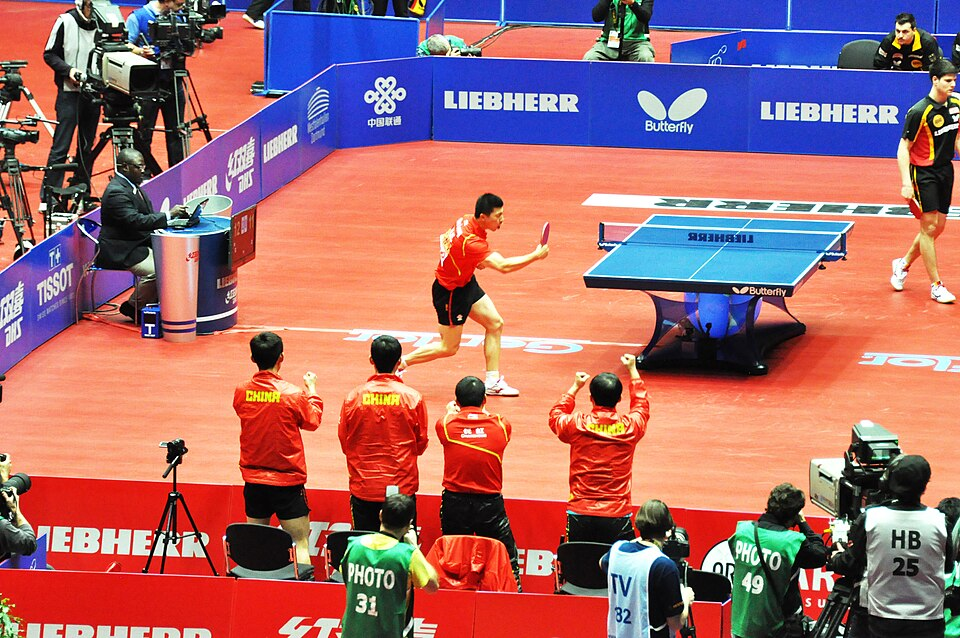

## Tiểu sử

Ma Long sinh năm 1988 tại An Sơn, Trung Quốc, là tay vợt thành công nhất lịch sử bóng bàn: tay vợt nam duy nhất giành Grand Slam hai lần và bảo vệ thành công HCV đơn Olympic. Anh là đội trưởng đội tuyển Trung Quốc — 'Captain Long'.

## Phong cách thi đấu

- Lối chơi hoàn hảo không điểm yếu — 'cỗ máy toàn diện'.
- Forehand loop quay mạnh nhất thế giới, chuyển tiếp forehand-backhand nhanh nhất.
- Điều khiển nhịp và bàn như 'nhà độc tài' — khiến đối thủ chơi theo ý mình.

<figure>
  
  <figcaption>Ma Long — ảnh: Wikimedia Commons</figcaption>
</figure>

## Thành tích & danh hiệu chính

- **Vàng đơn Olympic**: Rio 2016, Tokyo 2020 — tay vợt nam đầu tiên bảo vệ vàng đơn.
- **Vô địch thế giới đơn**: 2015, 2017, 2019 (3 lần liên tiếp).
- Nhiều vàng đồng đội Olympic (2012-2024), vô địch World Cup, Grand Finals.
- Số 1 thế giới tổng cộng hơn 60 tháng.

## Biệt danh

"Captain Long / The Dictator"

## Giai thoại

Ở Paris 2024, Ma Long tham dự Olympic lần thứ 5 ở tuổi 35 và giành thêm vàng đồng đội — HCV Olympic thứ 6, kỷ lục của thể thao Trung Quốc. Đối thủ gọi anh là 'bức tường cuối cùng' của bóng bàn.

*Nguồn tham khảo: ITTF/WTT, Wikipedia.*
