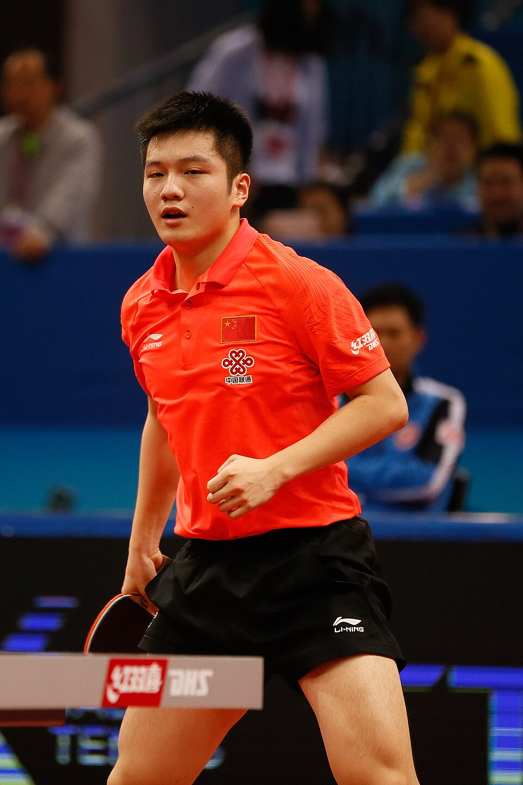

## Tiểu sử

Fan Zhendong sinh năm 1997 tại Quảng Châu, Trung Quốc, lên đội tuyển quốc gia năm 15 tuổi và vào top thế giới khi mới 17. Anh là người kế thừa chính thức ngôi vương của Ma Long, hoàn tất Grand Slam bằng vàng đơn Olympic Paris 2024.

## Phong cách thi đấu

- Cú backhand mạnh nhất thế giới — 'cánh tay phải' biến mọi đường bóng thành điểm số.
- Nền tảng thể lực khủng, đánh trụ lâu không mỏi.
- Lối chơi sức mạnh + chuẩn xác, tổng hợp của cả thế hệ Ma Long và Zhang Jike.

<figure>
  
  <figcaption>Fan Zhendong — ảnh: Wikimedia Commons</figcaption>
</figure>

## Thành tích & danh hiệu chính

- **Vàng đơn Olympic** Paris 2024 — hoàn tất Grand Slam.
- **Vô địch thế giới đơn**: 2021, 2023 (2 lần liên tiếp).
- HCB Olympic Tokyo 2020 (đơn), vàng đồng đội 2020 & 2024.
- Số 1 thế giới nhiều năm liền từ 2020.

## Biệt danh

"Xiao Pang / 'Tiểu béo'"

## Giai thoại

Chung kết Paris 2024 Fan Zhendong thắng Möregårdh sau khi từng bị loại cay ở Tokyo — anh khóc ôm HLV khi hoàn tất Grand Slam ở tuổi 27. Đó là tấm vàng đơn nam thứ 6 liên tiếp của Trung Quốc.

*Nguồn tham khảo: ITTF/WTT, Wikipedia.*
