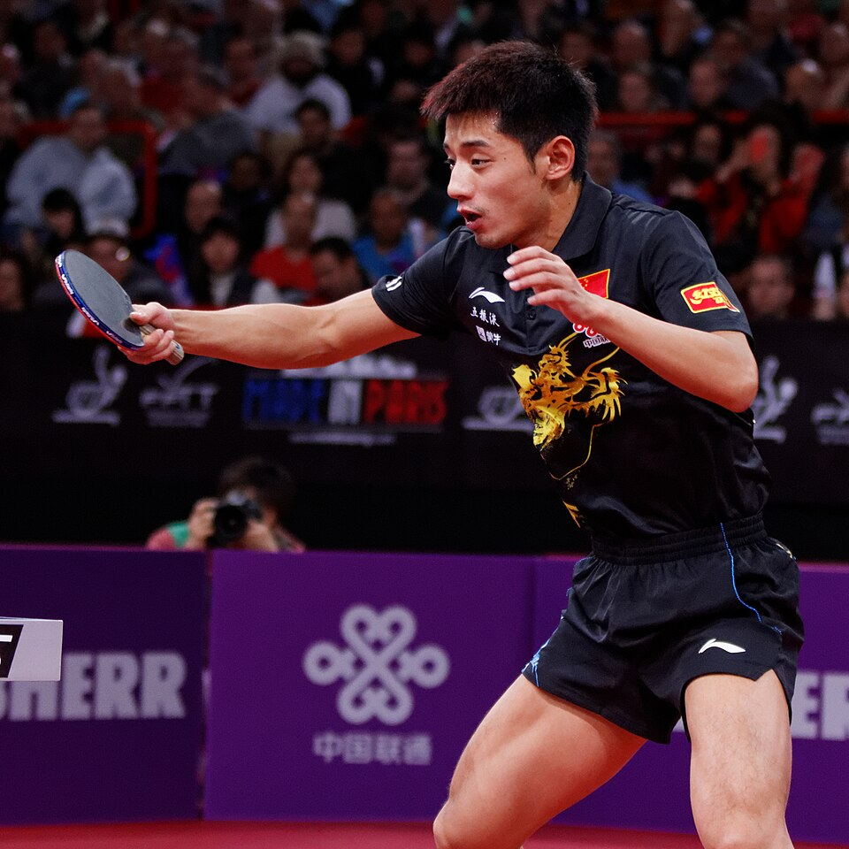

## Tiểu sử

Zhang Jike sinh năm 1988 tại Thanh Đảo, Trung Quốc, là tay vợt hoàn thành Grand Slam (Olympic + World + World Cup) nhanh nhất lịch sử: chỉ 445 ngày (2011-2012). Anh nổi tiếng cá tính bùng nổ nhất từng có trong bóng bàn.

## Phong cách thi đấu

- Backhand 'chiquita' (banana flick) cực mạnh — ông tổ của lối đánh trả giao công tích hiện đại.
- Sức bật và lực đập bóng bùng nổ từ thể hình lý tưởng.
- Đánh theo cảm hứng: lúc hay nhất không ai đỡ nổi.

<figure>
  
  <figcaption>Zhang Jike — ảnh: Wikimedia Commons</figcaption>
</figure>

## Thành tích & danh hiệu chính

- **Grand Slam trong 445 ngày** — kỷ lục thế giới (2011-2012).
- **Vàng đơn Olympic** London 2012; HCB đồng đội nhiều kỳ.
- **Vô địch thế giới đơn**: 2011, 2013; World Cup 2011, 2014.
- Số 1 thế giới.

## Biệt danh

"Kẻ ngủ gật / Tibetan Mastiff"

## Giai thoại

Nổi tiếng nhất là khoảnh khắc xé áo ăn mừng chức vô địch thế giới 2011 và cú đá vỡ bảng quảng cáo sau khi thắng World Cup 2014 (bị phạt toàn bộ tiền thưởng). Cá tính ấy làm anh thành ngôi sao pop-culture thực sự của bóng bàn.

*Nguồn tham khảo: ITTF/WTT, Wikipedia.*
