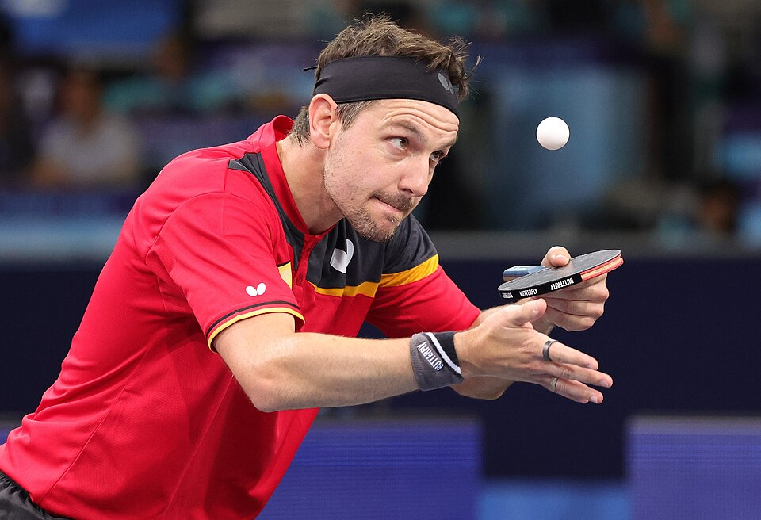

## Tiểu sử

Timo Boll sinh năm 1981 tại Erbach, Đức, là tay vợt châu Âu có sự nghiệp đỉnh cao dài nhất lịch sử: 25+ năm, 7 kỳ Olympic, và tới tận những năm 40 tuổi vẫn thắng được top 10 thế giới.

## Phong cách thi đấu

- Tay trái với cú loop forehand xoáy cực nặng — đặc sản 'topspin siêu quay'.
- Điều chỉnh nhịp thiên tài: đánh chậm-nhanh xen kẽ phá guồng đối thủ châu Á.
- Thể thao quý ông — fair-play được BWF... ITTF tôn vinh.

<figure>
  
  <figcaption>Timo Boll — ảnh: Wikimedia Commons</figcaption>
</figure>

## Thành tích & danh hiệu chính

- 7 lần dự Olympic (2000-2024); HCĐ đồng đội 2008, HCB đồng đội 2012-2020.
- Số 1 thế giới 2 lần (2003, 2011).
- 8 lần vô địch đơn châu Âu, nhiều danh hiệu World Tour.
- HCB World Cup 2002, 2005, 2012.

## Biệt danh

"Timo"

## Giai thoại

Năm 2021, ở tuổi 40, Boll vẫn đánh bại Fan Zhendong ở giải lớn. Anh là tấm gương hiếm có: đỉnh cao kéo dài qua 5 thế hệ tay vợt Trung Quốc mà phong cách quý ông không bao giờ đổi.

*Nguồn tham khảo: ITTF/WTT, Wikipedia.*
