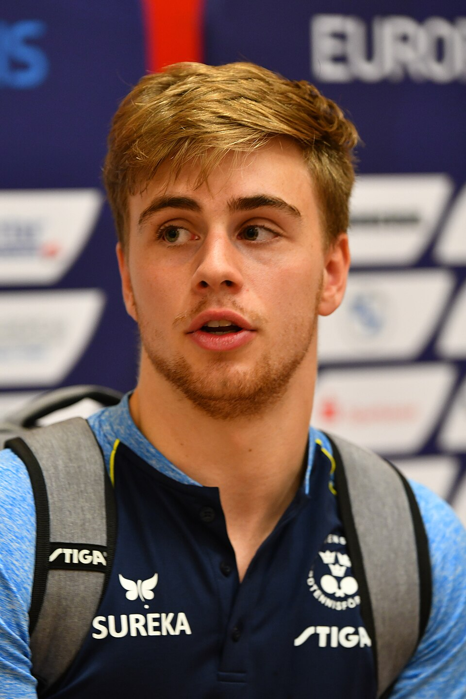

## Tiểu sử

Truls Möregårdh sinh năm 2002 tại Hovmantorp, Thụy Điển, là sự nghiệp trẻ 'nổi loạn' nhất bóng bàn hiện đại — vào chung kết thế giới 2021 rồi HCB Olympic Paris 2024, kết thúc 24 năm chờ huy chương đơn của cầu lông... à, bóng bàn Thụy Điển.

## Phong cách thi đấu

- Cây vợt lục giác 'Cybershape' độc nhất top đấu — vùng ngọt rộng hơn vợt tròn.
- Đánh 'không theo nhịp': thay đổi tốc độ và góc bất thường như Waldner thời mới.
- Cá tính bùng nổ — vừa thua điểm có thể ngay lập tức đánh cú 'không tưởng'.

<figure>
  
  <figcaption>Truls Möregårdh — ảnh: Wikimedia Commons</figcaption>
</figure>

## Thành tích & danh hiệu chính

- **HCB Olympic** Paris 2024 — huy chương đơn đầu tiên của Thụy Điển sau 24 năm.
- **HCB vô địch thế giới** 2021 (Houston) ở tuổi 19.
- Vàng đôi nam thế giới? — nhiều danh hiệu European Games, top 10 BWF... WTT thế giới.

## Biệt danh

"Truls"

## Giai thoại

Möregårdh từng bỏ học năm 16 tuổi để theo bóng bàn. Chung kết Paris 2024 anh thua Fan Zhendong nhưng nụ cười tươi khi nhận HCB khiến anh được yêu thích toàn cầu — 'người vui nhất từng đoạt bạc'.

*Nguồn tham khảo: ITTF/WTT, Wikipedia.*
