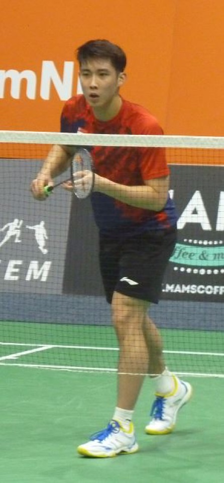

## Tiểu sử

Loh Kean Yew sinh ngày 26/6/1997 tại Penang (Malaysia), sang Singapore học tại trường Thể thao và nhập tịch năm 2015. Anh đi vào lịch sử khi trở thành **nhà vô địch thế giới đầu tiên của Singapore** tại giải Vô địch thế giới 2021 ở Huelva.

<figure class="fig-left">
  
  <figcaption>Loh Kean Yew — năm 2021 lịch sử của cầu lông Singapore (ảnh: Wikimedia Commons)</figcaption>
</figure>

## Phong cách thi đấu

- **Tốc độ sân siêu nhanh** — thuộc nhóm VĐV di chuyển nhanh nhất thế giới.
- Đánh chéo sân bất ngờ, cú nhảy smash từ biên trái rất khó lường.
- Thể lực dẻo, lối chơi pressing không ngừng khiến đối thủ kiệt sức.

## Thành tích & danh hiệu chính

- **Vô địch thế giới 2021** — HCV đơn nam, người Singapore đầu tiên đoạt HCV thế giới.
- Cao nhất **số 3 thế giới** (2022).
- **HCV SEA Games 2019** đơn nam — chấm dứt 26 năm chờ vàng SEA của Singapore.
- Nhiều danh hiệu World Tour: Hylo Open, Madrid Spain Masters, Korea Masters.
- HCĐ Commonwealth Games 2022; tứ kết Olympic Paris 2024.

## Biệt danh

"LKY"

## Giai thoại

Đường đến HCV 2021 của Loh là "đường hầm của các ông lớn": hạ Axelsen (Olympic champion), Antonsen, lật đổ Srikanth ở chung kết — chuỗi trận được xem là cú chạy kỳ diệu nhất lịch sử cầu lông Singapore, và khiến anh được trao danh hiệu VĐV của năm của đảo quốc.

## Video

  <iframe src="https://www.youtube.com/embed/w7a8k8UTkRo" title="Loh Kean Yew — bán kết Vô địch thế giới 2021" loading="lazy" allowfullscreen></iframe>

*Loh Kean Yew (Singapore) vs Anders Antonsen (Đan Mạch) — bán kết Vô địch thế giới 2021. Nguồn: BWF TV.*

*Nguồn tham khảo: BWF, Wikipedia. Ảnh: Wikimedia Commons.*
