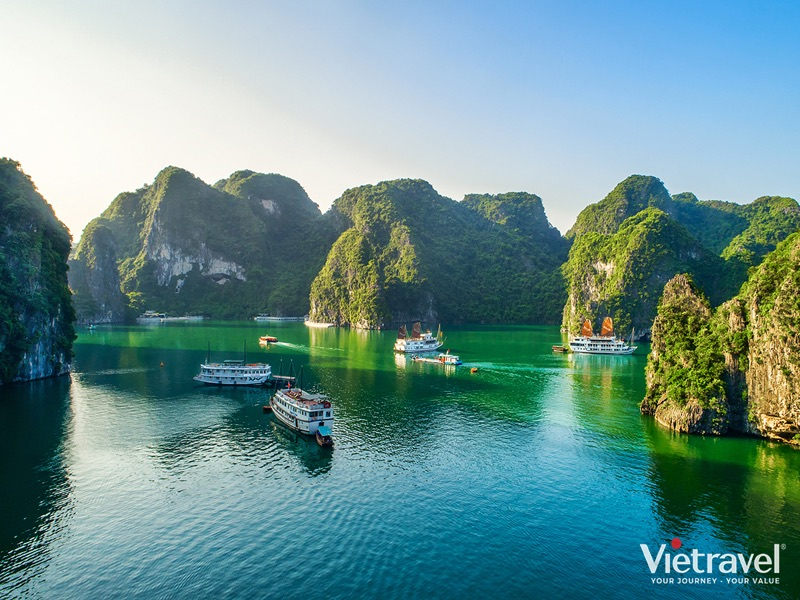
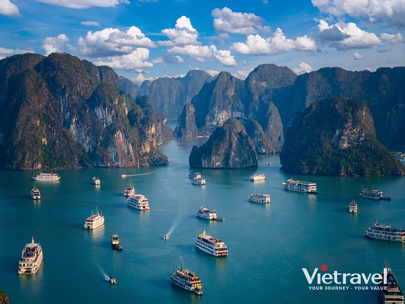
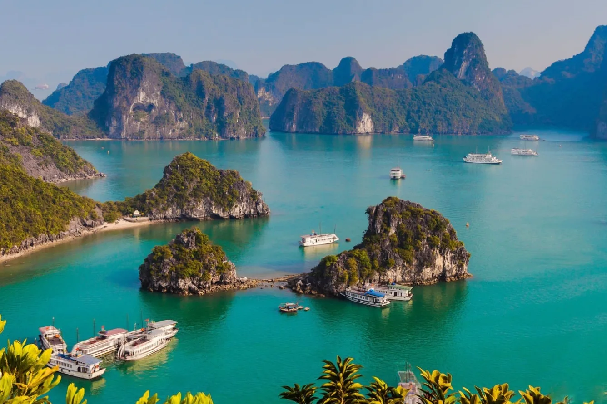
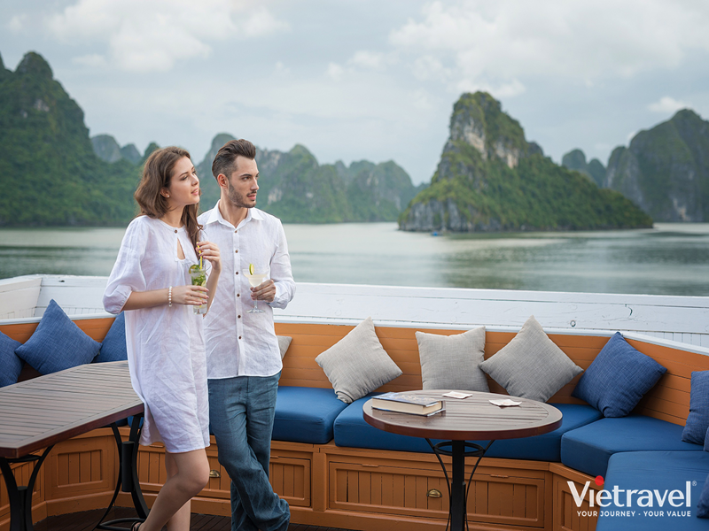
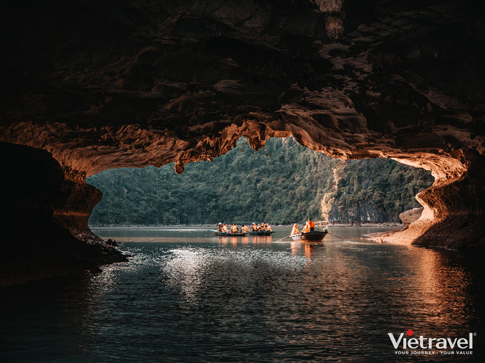
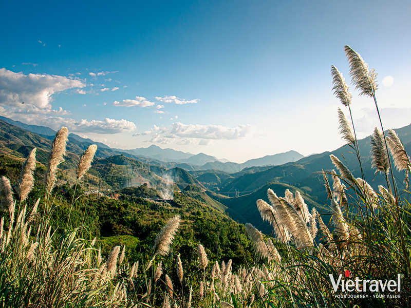
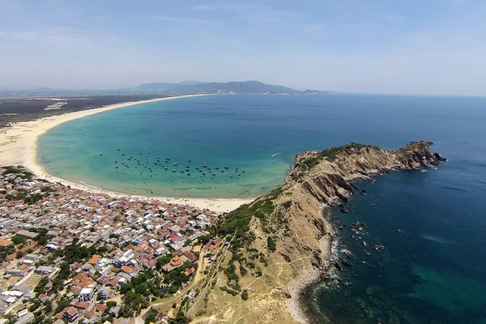
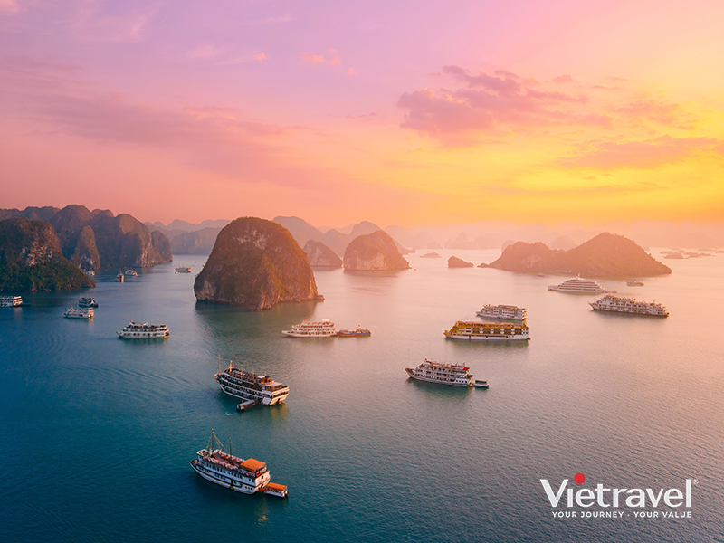

## Tổng quan

Quảng Ninh là tỉnh đông bắc Việt Nam sở hữu vịnh Hạ Long — hai lần UNESCO công nhận Di sản thiên nhiên thế giới và một trong "7 kỳ quan thiên nhiên mới". Ngoài biển đảo, Quảng Ninh còn là quê hương của thiền phái Trúc Lâm và vùng khai mỏ lớn nhất nước.

## Địa lý & khí hậu

- **Vị trí:** cực đông bắc Việt Nam, giáp Quảng Tây (Trung Quốc), cách Hà Nội ~150km.
- **Địa hình:** vừa biển vừa núi — ~2.000 đảo đá vôi trên vịnh, dãy Đông Triều phía tây.
- **Khí hậu:** đẹp nhất tháng 4–6 và 9–11; tránh mùa bão tháng 7–8.

## Lịch sử & văn hóa

Quảng Ninh gắn với chiến thắng Bạch Đằng lừng lẫy của quân dân Việt qua 3 lần đánh thắng quân Nguyên – Mông. Núi Yên Tử là nơi vua Trần Nhân Tông xuất gia sáng lập thiền phái Trúc Lâm — thiền phái đầu tiên của người Việt. Văn hóa mỏ với những đời công nhân mỏ cũng là nét đặc trưng riêng.

## Điểm đến nổi bật

<figure class="fig-left">
  
  <figcaption>Làng chài nổi giữa các đảo đá vôi trên vịnh Hạ Long (ảnh: Vietravel)</figcaption>
</figure>

### Vịnh Hạ Long

Gần 2.000 đảo đá vôi nhô lên mặt biển xanh ngọc — du thuyền qua động Thiên Cung, hang Sửng Sốt, đảo Titop và các làng chài nổi.

### Vịnh Lan Hạ & Cát Bà liên tuyến

Phần vịnh phía nam ít đông hơn, thích hợp kayak, bơi lội và ngủ đêm trên thuyền giữa vịnh.

### Yên Tử

Quần thể di tích thiền phái Trúc Lâm trên đỉnh núi 1.068m — chùa Hoa Yên, chùa Đồng, đường cáp treo xuyên rừng thông cổ thụ.

<figure class="fig-right">
  
  <figcaption>Du thuyền giữa các đảo đá vôi của vịnh Hạ Long (ảnh: Vietravel)</figcaption>
</figure>

## Ẩm thực đặc sản

- **Chả mực Hạ Long:** chả mực giã tay nổi tiếng cả nước, dai giòn thơm mực tươi.
- **Ngán:** loại hải sản đặc trưng vùng Vân Đồn, chế biến thành nhiều món ngon.
- **Bánh gật gù Tiên Yên:** bánh gạo cuộn chấm nước mắm gừng — món ăn dân dã vùng Đông Bắc.

## Điều thú vị ít người biết

- Vịnh Hạ Long được UNESCO công nhận Di sản thế giới **2 lần**: 1994 (cảnh quan) và 2000 (địa chất) — điều hiếm có trên thế giới.
- Truyền thuyết vịnh Hạ Long gắn với đàn rồng mẹ và rồng con đá xuống tạo thành các đảo — "Hạ Long" nghĩa là "rồng đáp xuống".
- Đảo Tuần Châu từng là nơi dưỡng thư của Vua Bảo Đại và Chủ tịch Hồ Chí Minh.

## Thư viện ảnh

  <figure><figcaption>Vịnh Hạ Long nhìn từ trên cao (ảnh: Vietravel)</figcaption></figure>
  <figure><figcaption>Du thuyền tham quan vịnh (ảnh: Vietravel)</figcaption></figure>
  <figure><figcaption>Du thuyền giữa các đảo đá vôi (ảnh: Vietravel)</figcaption></figure>
  <figure><figcaption>Cao nguyên Bình Liêu (ảnh: Vietravel)</figcaption></figure>
  <figure><figcaption>Cảnh biển Quảng Ninh (ảnh: Vietravel)</figcaption></figure>
  <figure><figcaption>Vịnh Hạ Long (ảnh: Vietravel)</figcaption></figure>

## Video

  <iframe src="https://www.youtube.com/embed/SLWLTuab5tU?start=56" title="Vịnh Hạ Long — Vietnam 8K HDR" loading="lazy" allow="accelerometer; autoplay; clipboard-write; encrypted-media; gyroscope; picture-in-picture" allowfullscreen></iframe>

  <iframe src="https://www.youtube.com/embed/KsSGZkd1im0" title="Ha Long Bay Flying Tour 4K" loading="lazy" allow="accelerometer; autoplay; clipboard-write; encrypted-media; gyroscope; picture-in-picture" allowfullscreen></iframe>

  <iframe src="https://www.youtube.com/embed/vt9OL_sJ5gA" title="Ha Long Bay UNESCO 4K" loading="lazy" allow="accelerometer; autoplay; clipboard-write; encrypted-media; gyroscope; picture-in-picture" allowfullscreen></iframe>

*Ảnh: Vietravel (travel.com.vn). Video: 8K Nature & Travel HDR (đoạn vịnh Hạ Long).*
