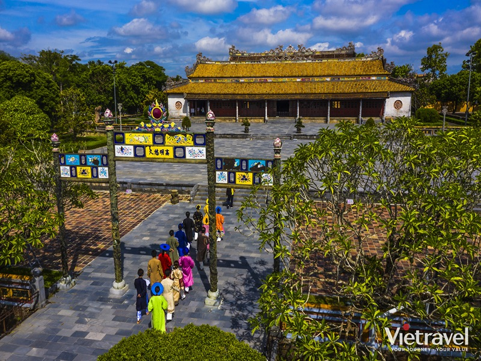
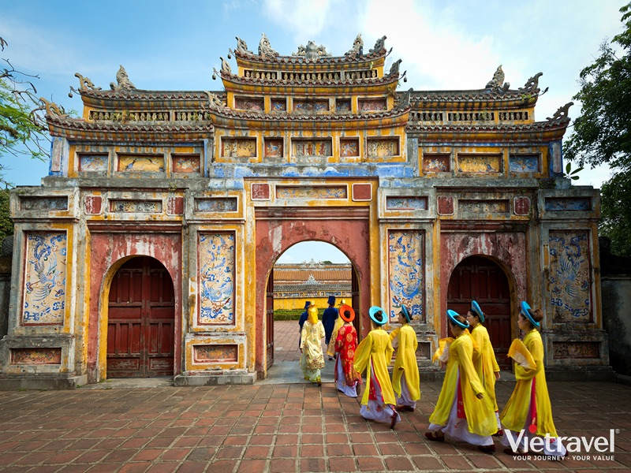

## Tổng quan

Huế (TP. Huế trực thuộc trung ương) là cố đô của triều Nguyễn — vương triều cuối cùng của Việt Nam — nổi tiếng với Cố đô UNESCO, hệ thống lăng tẩm các vua, ca Huế trên sông Hương và ẩm thực cung đình tinh tế.

## Địa lý & khí hậu

- **Vị trí:** duyên hải miền Trung, cách Đà Nẵng ~100km qua đèo Hải Vân.
- **Địa hình:** sông Hương chảy qua trung tâm; phá Tam Giang – Cầu Hai là hệ đầm phá lớn nhất Đông Nam Á.
- **Khí hậu:** đẹp nhất tháng 1–4 (Festival Huế chẵn năm) và mùa hè; mùa mưa lũ tháng 9–11.

## Lịch sử & văn hóa

Huế là kinh đô của 9 chúa Nguyễn (1558–1775) và 13 vị vua triều Nguyễn (1802–1945) — nơi lưu giữ gần như trọn vẹn bộ máy cung đình phong kiến cuối cùng của Á Đông. Ca Huế (nhã nhạc cung đình) được UNESCO công nhận Di sản văn hóa phi vật thể đầu tiên của Việt Nam.

## Điểm đến nổi bật

<figure class="fig-left">
  
  <figcaption>Đại Nội Huế — kinh thành của 13 vị vua triều Nguyễn (ảnh: Vietravel)</figcaption>
</figure>

### Đại Nội (Hoàng thành)

Kinh thành nguy nga của triều Nguyễn với Ngọ Môn, điện Thái Hòa, Tử Cấm Thành — trung tâm quyền lực 143 năm của các vua Nguyễn.

### Các lăng tẩm vua

Lăng Tự Đức thơ mộng, lăng Khải Định kiến trúc gốm sứ độc nhất, lăng Minh Mạng nghiêm trang — mỗi lăng là một tác phẩm kiến trúc – cảnh quan.

### Sông Hương & chùa Thiên Mụ

Nghe ca Huế trên thuyền rồng dọc sông Hương, ngắm tháp Phước Duyên của chùa Thiên Mụ — biểu tượng lâu đời của cố đô.

<figure class="fig-right">
  
  <figcaption>Cổng cung đình bên trong Đại Nội (ảnh: Vietravel)</figcaption>
</figure>

## Ẩm thực đặc sản

- **Bún bò Huế:** món ăn sáng quốc hồn quốc túy với vị sả ớt đặc trưng.
- **Cơm hến/múi hến:** món ăn dân dã từ phá Tam Giang không đâu có được.
- **Chè cung đình & bánh Huế:** chè hạt sen, chè môn; bánh bèo, bánh nậm, bánh lọc.

## Điều thú vị ít người biết

- Nhã nhạc cung đình Huế là **di sản văn hóa phi vật thể đầu tiên** của Việt Nam được UNESCO công nhận (2003).
- Năm 2025 Huế trở thành **thành phố trực thuộc trung ương** thứ 6 của Việt Nam.
- Chùa Thiên Mụ xây năm 1601 — ngôi chùa cổ nhất Huế, từng trung tâm Phật giáo cả nước thời Nguyễn.

## Video

  <iframe src="https://www.youtube.com/embed/ew9oWlg1yu0" title="The Imperial City of Hue — Vietnam Today" loading="lazy" allow="accelerometer; autoplay; clipboard-write; encrypted-media; gyroscope; picture-in-picture" allowfullscreen></iframe>

*Ảnh: Vietravel (travel.com.vn). Video: Vietnam Today.*
