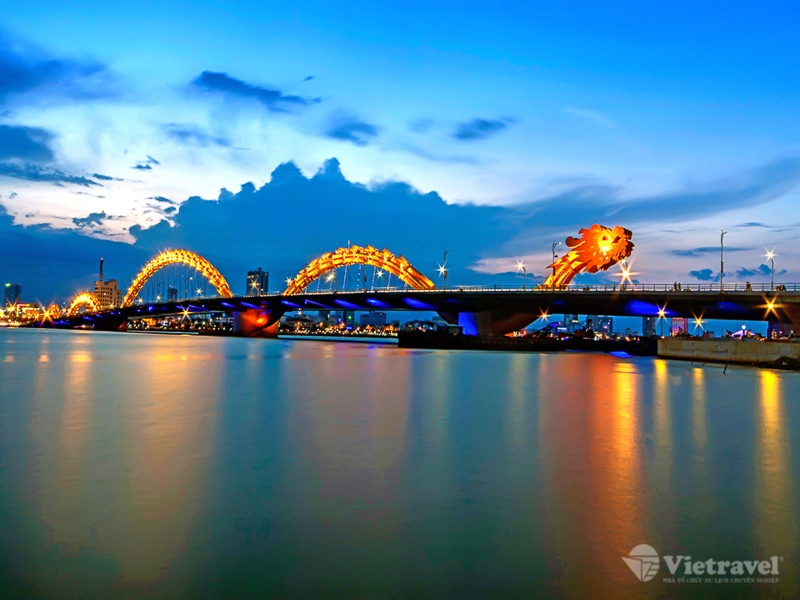
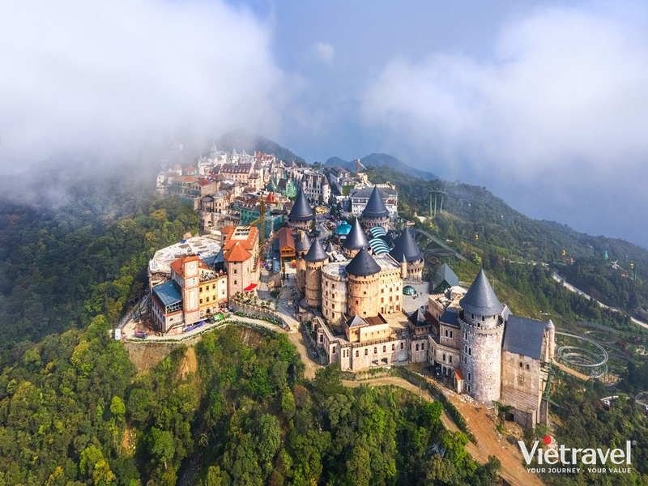

## Tổng quan

Đà Nẵng là thành phố trực thuộc trung ương lớn nhất miền Trung, được mệnh danh "thành phố đáng sống nhất Việt Nam" — nơi hội tụ biển đẹp, sông Hàn, bán đảo Sơn Trà và những cây cầu biểu tượng, cửa ngõ của dải di sản Huế – Đà Nẵng – Hội An.

## Địa lý & khí hậu

- **Vị trí:** duyên hải Nam Trung Bộ, cách Huế ~100km và Hội An ~30km.
- **Địa hình:** biển, sông và núi đủ cả — bán đảo Sơn Trà, núi Ngũ Hành Sơn, bãi biển Mỹ Khê.
- **Khí hậu:** đẹp nhất tháng 2–8; mùa mưa bão tháng 9–12.

## Lịch sử & văn hóa

Đà Nẵng từng là cảng thương mại quan trọng của vương quốc Chăm Pa rồi đô thị kiểu mẫu thời Pháp (Tourane). Năm 1965, bãi biển Đà Nẵng là nơi quân Mỹ đầu tiên đổ bộ trong chiến tranh Việt Nam. Ngày nay thành phố nổi tiếng với Lễ hội pháo hoa quốc tế DIFF và cái tên "thành phố của những cây cầu".

## Điểm đến nổi bật

<figure class="fig-left">
  
  <figcaption>Cầu Rồng về đêm — biểu tượng của Đà Nẵng (ảnh: Vietravel)</figcaption>
</figure>

### Cầu Rồng & sông Hàn

Cây cầu hình rồng phun lửa – phun nước vào cuối tuần; dạo bộ bờ sông Hàn ngắm cầu quay Sông Hàn và cầu Thuận Phước về đêm.

### Bà Nà Hills & Cầu Vàng

Khu du lịch trên đỉnh núi 1.487m với cáp treo kỷ lục, Cầu Vàng được đôi bàn tay đá khổng lồ nâng đỡ — biểu tượng du lịch toàn cầu.

### Bãi biển Mỹ Khê & Sơn Trà

Bãi biển từng được Forbes bình chọn một trong những bãi biển quyến rũ nhất hành tinh; bán đảo Sơn Trà có chùa Linh Ứng tượng Quán Âm 67m.

<figure class="fig-right">
  
  <figcaption>Khu du lịch Bà Nà Hills trên đỉnh núi (ảnh: Vietravel)</figcaption>
</figure>

## Ẩm thực đặc sản

- **Mì Quảng:** mì nước ít với tôm, thịt, đậu phộng — món ăn tỉnh Quảng Nam gốc.
- **Bánh tráng cuốn thịt heo:** cuốn thịt heo hai đầu da chấm mắm nêm.
- **Bún chả cá & hải sản:** bún chả cá Đà Nẵng chua cay đặc trưng; hải sản tươi dọc bãi biển.

## Điều thú vị ít người biết

- Cầu Rồng là **cây cầu lớn nhất Việt Nam hình rồng** — phun lửa 9 phút liên tục vào cuối tuần.
- Đà Nẵng nằm giữa **3 di sản thế giới UNESCO**: cố đô Huế, phố cổ Hội An và thánh địa Mỹ Sơn.
- Cáp treo Bà Nà giữ nhiều kỷ lục thế giới về chiều dài và độ chênh cao nhất thế giới một thời.

## Video

  <iframe src="https://www.youtube.com/embed/SLWLTuab5tU?start=2037" title="Đà Nẵng — Vietnam 8K HDR" loading="lazy" allow="accelerometer; autoplay; clipboard-write; encrypted-media; gyroscope; picture-in-picture" allowfullscreen></iframe>

*Ảnh: Vietravel (travel.com.vn). Video: 8K Nature & Travel HDR (đoạn Đà Nẵng).*
