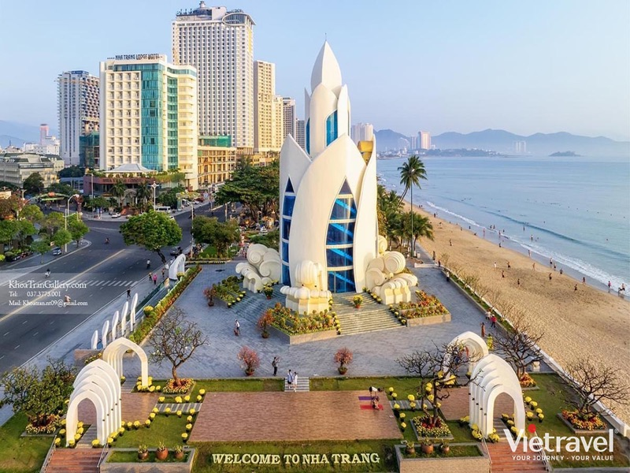
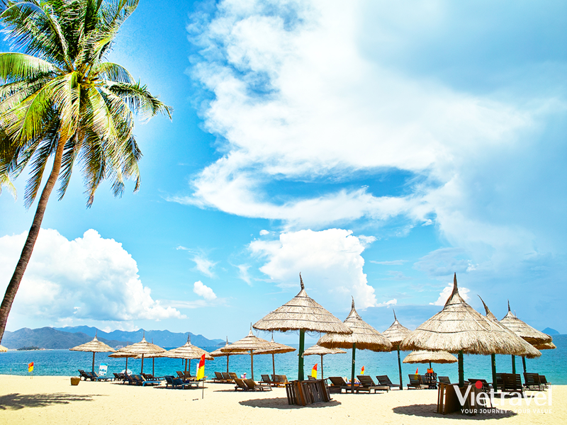
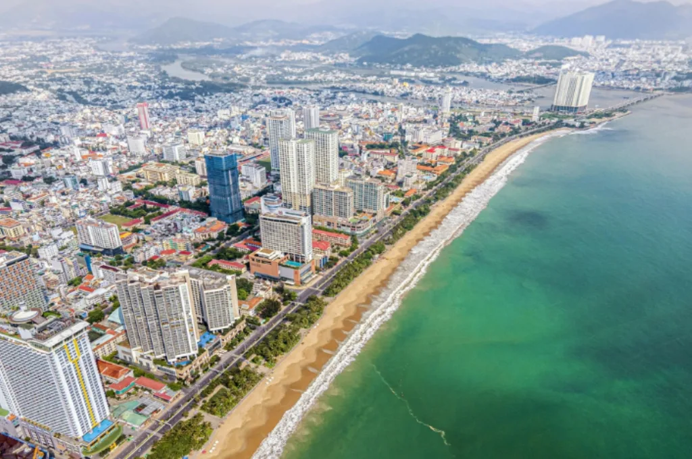
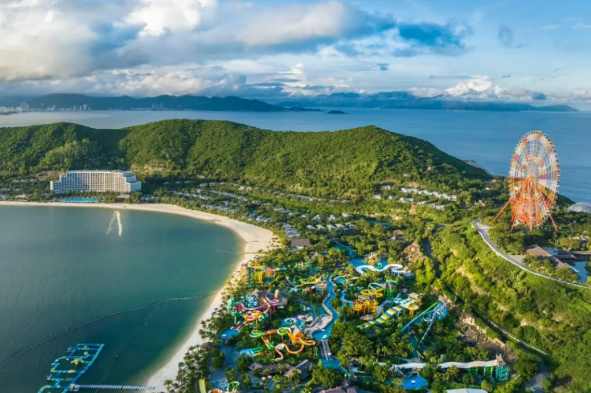
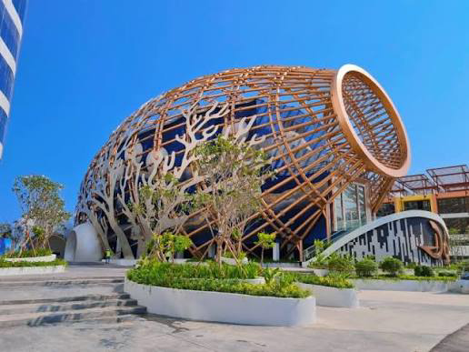
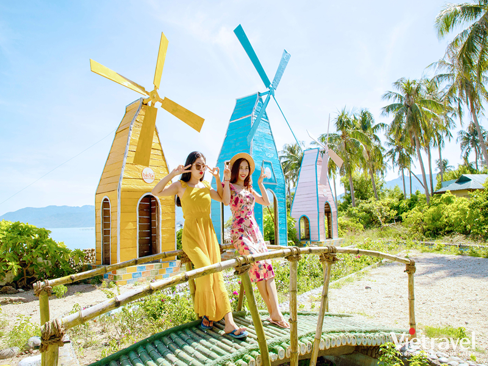
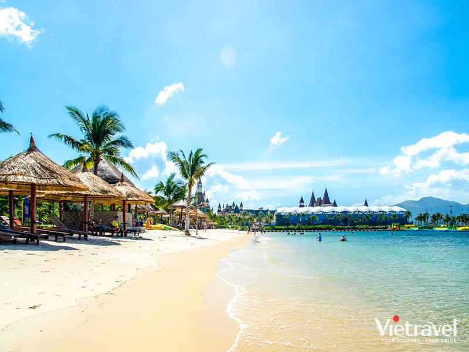

## Tổng quan

Khánh Hòa là tỉnh duyên hải Nam Trung Bộ với thành phố biển Nha Trang — một trong những vịnh biển đẹp nhất thế giới, quê hương của nước mắm và yến sào, và nơi lưu giữ di sản văn hóa Chăm Pa cổ đại.

## Địa lý & khí hậu

- **Vị trí:** duyên hải Nam Trung Bộ, cách TPHCM ~450km, sân bay quốc tế Cam Ranh.
- **Địa hình:** vịnh Nha Trang sâu kín gió với 19 đảo lớn nhỏ; đèo Cả, đèo Cù Mông ôm biển.
- **Khí hậu:** nắng quanh năm, đẹp nhất tháng 1–8; mùa mưa ngắn tháng 10–12.

## Lịch sử & văn hóa

Vùng đất Khánh Hòa từng thuộc vương quốc Chăm Pa — tháp Po Nagar từ thế kỷ 8–13 là trung tâm thờ nữ thần Yang Inô Po Nagar. Thời Pháp thuộc, Nha Trang là trạm biển nghỉ dưỡng; năm 1923 Viện Hải dương học Nha Trang ra đời — viện nghiên cứu biển đầu tiên của Đông Dương.

## Điểm đến nổi bật

<figure class="fig-left">
  
  <figcaption>Hòn Chồng — điểm ngắm vịnh Nha Trang đẹp nhất (ảnh: Vietravel)</figcaption>
</figure>

### Vịnh Nha Trang & các đảo

Tắm biển dọc bờ Trần Phú, lặn ngắm san hô Hòn Mun, vui chơi VinWonders trên đảo Hòn Tre và đảo Khỉ Hòn Lao.

### Tháp Bà Po Nagar

Quần thể tháp Chăm trên đồi ven sông Cái — công trình kiến trúc Chăm Pa còn nguyên vẹn nhất miền Trung Nam.

### Hòn Chồng & suối khoáng Tháp Bà

Nhóm đá chồng chất kỳ vĩ nhìn ra vịnh; tắm bùn khoáng Tháp Bà — trải nghiệm nghỉ dưỡng đặc trưng Nha Trang.

<figure class="fig-right">
  
  <figcaption>Tháp Trầm Hương — biểu tượng mới trên quảng trường ven biển Nha Trang (ảnh: Vietravel)</figcaption>
</figure>

## Ẩm thực đặc sản

- **Bún chả cá & bánh căn:** bánh căn nước mắm xoài là món ăn sáng quốc dân Nha Trang.
- **Nem nướng Ninh Hòa:** nem nướng cuốn rau sống chấm tương — món đặc trưng không thể bỏ qua.
- **Yến sào & tôm hùm:** yến sào đảo thiên nhiên danh tiếng; tôm hùm nuôi lồng vịnh Vân Phong.

## Điều thú vị ít người biết

- Vịnh Nha Trang là thành viên của **"Câu lạc bộ các vịnh đẹp nhất thế giới"** (2003).
- Nha Trang là **thủ phủ yến sào** của Việt Nam — đảo Yến có hang yến tự nhiên lớn nhất nước, nghề khai yến từ 700 năm trước.
- Tháp Bà Po Nagar mỗi năm tháng 3 âm lịch tổ chức lễ hội lớn nhất của đồng bào Chăm miền Trung.

## Thư viện ảnh

  <figure><figcaption>Bãi biển Nha Trang (ảnh: Vietravel)</figcaption></figure>
  <figure><figcaption>Toàn cảnh bờ biển Nha Trang (ảnh: Vietravel)</figcaption></figure>
  <figure><figcaption>Vịnh Nha Trang nhìn từ trên cao (ảnh: Vietravel)</figcaption></figure>
  <figure><figcaption>Nhà hát Đó Nha Trang (ảnh: Vietravel)</figcaption></figure>
  <figure><figcaption>Điểm check-in nổi tiếng ở Nha Trang (ảnh: Vietravel)</figcaption></figure>
  <figure><figcaption>Biển đảo Nha Trang (ảnh: Vietravel)</figcaption></figure>

## Video

  <iframe src="https://www.youtube.com/embed/SLWLTuab5tU?start=2636" title="Nha Trang — Vietnam 8K HDR" loading="lazy" allow="accelerometer; autoplay; clipboard-write; encrypted-media; gyroscope; picture-in-picture" allowfullscreen></iframe>

  <iframe src="https://www.youtube.com/embed/aSHOROIjhbg" title="Nha Trang Flycam 4K" loading="lazy" allow="accelerometer; autoplay; clipboard-write; encrypted-media; gyroscope; picture-in-picture" allowfullscreen></iframe>

  <iframe src="https://www.youtube.com/embed/yunL6QfMO5Q" title="Nha Trang 4K Cinematic" loading="lazy" allow="accelerometer; autoplay; clipboard-write; encrypted-media; gyroscope; picture-in-picture" allowfullscreen></iframe>

*Ảnh: Vietravel (travel.com.vn). Video: 8K Nature & Travel HDR (đoạn Nha Trang).*
