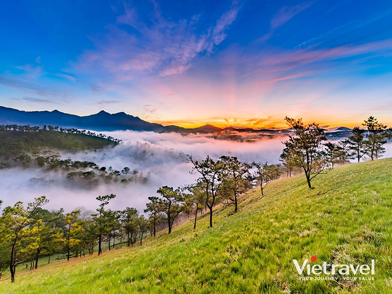
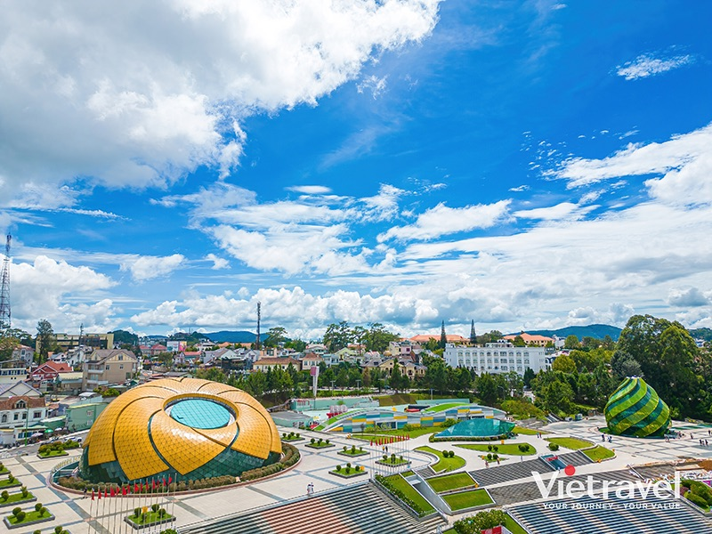

## Tổng quan

Lâm Đồng là tỉnh Tây Nguyên với thủ phủ Đà Lạt — thành phố ngàn hoa ở độ cao 1.500m, thủ phủ nông nghiệp công nghệ cao của cả nước, và điểm đến lãng mạn quen thuộc của du khách cả trăm năm qua.

## Địa lý & khí hậu

- **Vị trí:** Tây Nguyên nam, cách TPHCM ~300km qua cao tốc Dầu Giây – Liên Khương.
- **Địa hình:** cao nguyên Lâm Viên – Di Linh 800–1.500m, rừng thông, hồ và thác.
- **Khí hậu:** mát mẻ quanh năm 15–24°C; đẹp nhất mùa khô tháng 11–4; mùa hoa dã quỳ tháng 10–11.

## Lịch sử & văn hóa

Đà Lạt được bác sĩ Alexandre Yersin phát hiện năm 1893 khi tìm nguồn sông Đồng Nai. Người Pháp quy hoạch nó thành trạm nghỉ dưỡng cao nguyên với kiến trúc biệt thự châu Âu. Vùng đất này là quê hương của các dân tộc K'Ho, Mạ với văn hóa cồng chiêng Tây Nguyên — di sản phi vật thể UNESCO.

## Điểm đến nổi bật

<figure class="fig-left">
  
  <figcaption>Quảng trường Lâm Viên với công trình hoa dã quỳ và nụ atiso khổng lồ (ảnh: Vietravel)</figcaption>
</figure>

### Hồ Xuân Hương & quảng trường Lâm Viên

Trái tim của Đà Lạt — hồ nước hình trăng lưỡi liềm giữa trung tâm, quảng trường có nhà kính hoa dã quỳ và nụ atiso.

### Thác Datanla, Thác Pongour & thác Elephant

Datanla với máng trượt alpine coaster xuyên rừng; Pongour — "Nam thiên đệ nhất thác" nước đổ 7 tầng đá.

### Đồi Mộng Mơ, ga Đà Lạt & các nông trại

Đồi Mộng Mơ lãng mạn cổ kính; ga xe lửa cổ nhất Việt Nam; các vườn dâu, cà phê, hồng giòn trải nghiệm hái tại vườn.

<figure class="fig-right">
  
  <figcaption>Toàn cảnh thành phố Đà Lạt trong sương sớm (ảnh: Vietravel)</figcaption>
</figure>

## Ẩm thực đặc sản

- **Bánh căn Đà Lạt:** bánh căn trứng chấm nước mắm xíu mại — món ăn sáng không thể bỏ lỡ.
- **Lẩu gà lá é & sữa đậu nành:** ẩm thực gắn liền với khí trời se lạnh Đà Lạt.
- **Cà phê, dâu, atiso, rượu vang:** thủ phủ cà phê Arabica và rượu vang đầu tiên của Việt Nam.

## Điều thú vị ít người biết

- Đà Lạt là nơi **đầu tiên của Việt Nam sản xuất rượu vang** từ nho — hãng rượu có hơn 100 năm tuổi.
- Tên "Đà Lạt" ghép từ "Đạ Lạch" — dòng sông của người Lạch (K'Ho), và theo truyền thuyết "dòng suối của người Lạt".
- Hoa dã quỳ đồng bào Tây Nguyên gọi là "hoa ba xương" — nở vàng rực cả sườn đồi mỗi tháng 10–11.

## Video

  <iframe src="https://www.youtube.com/embed/SLWLTuab5tU?start=2728" title="Đà Lạt — Vietnam 8K HDR" loading="lazy" allow="accelerometer; autoplay; clipboard-write; encrypted-media; gyroscope; picture-in-picture" allowfullscreen></iframe>

*Ảnh: Vietravel (travel.com.vn). Video: 8K Nature & Travel HDR (đoạn Đà Lạt).*
