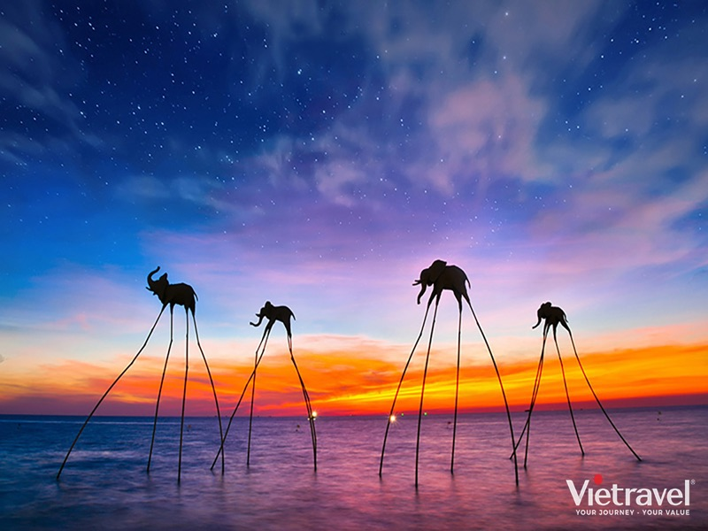
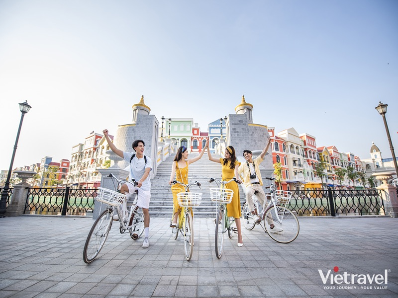
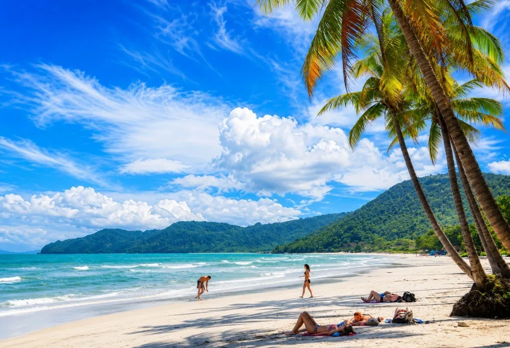
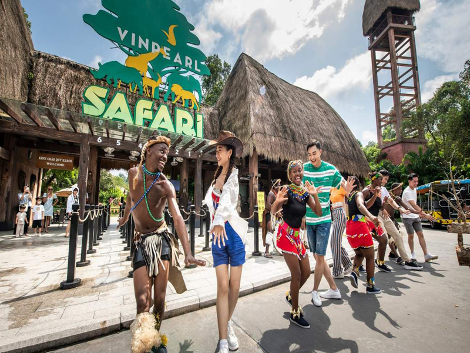
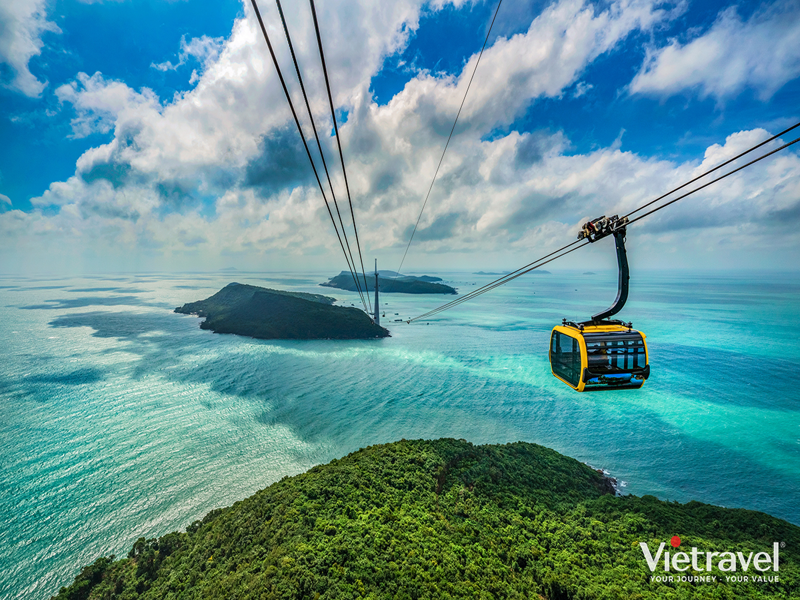
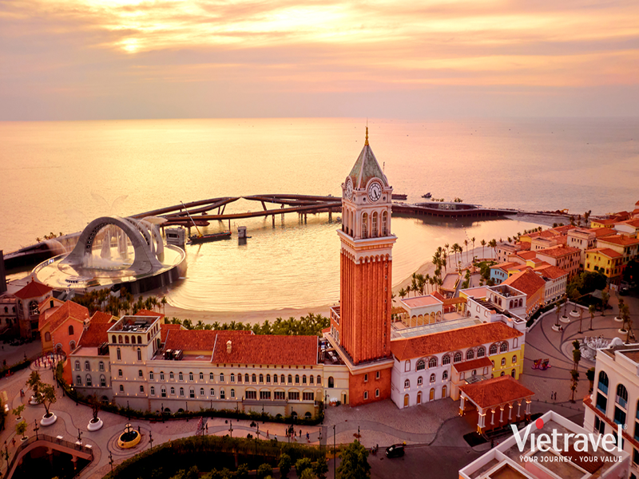
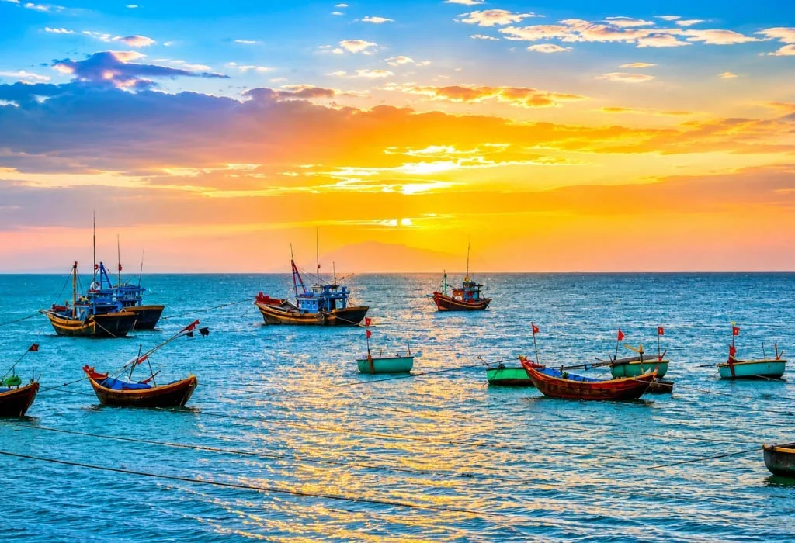
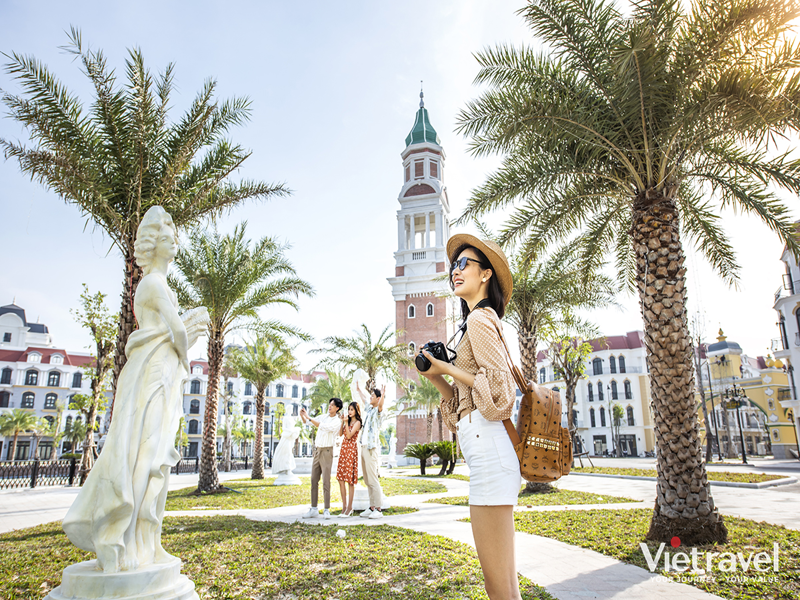

## Tổng quan

Kiên Giang là tỉnh cực Tây Nam của Việt Nam với đảo Phú Quốc — hòn đảo lớn nhất cả nước được mệnh danh "đảo ngọc", thủ phủ nước mắm truyền thống, vùng biển giàu hải sản và điểm du lịch biển phát triển nhanh nhất Đông Nam Á.

## Địa lý & khí hậu

- **Vị trí:** vịnh Thái Lan, cực Tây Nam Việt Nam, gần Campuchia; sân bay quốc tế Phú Quốc.
- **Địa hình:** đảo Phú Quốc 574km² với núi Chúa 603m, 150km bờ biển; quần đảo Nam Du, Hải Tặc, Bà Lụa.
- **Khí hậu:** đẹp nhất mùa khô tháng 11–4 (biển lặng nước trong); mùa mưa tháng 5–10.

## Lịch sử & văn hóa

Kiên Giang từng thuộc lãnh thổ Hà Tiên của chúa Nguyễn — do Mạc Cửu khai khẩn đầu thế kỷ 18. Phú Quốc từng là trại tù Phú Quốc thời chiến tranh với hơn 40.000 tù nhân. Nghề làm nước mắm truyền thống trên đảo có hơn 200 năm lịch sử — được công nhận Di sản văn hóa phi vật thể quốc gia.

## Điểm đến nổi bật

<figure class="fig-left">
  
  <figcaption>Hoàng hôn trên bãi biển Sanato — khung cảnh "sống ảo" nổi tiếng của Phú Quốc (ảnh: Vietravel)</figcaption>
</figure>

### Bãi Sao & Bãi Khem

Bãi biển cát trắng mịn như kem, nước trong xanh ngọc — thuộc top bãi biển đẹp nhất hành tinh theo bình chọn quốc tế.

### Sunset Town & chợ đêm Dương Đông

Thị trấn hoàng hôn kiểu Địa Trung Hải với cáp treo vượt biển dài nhất thế giới ra đảo Hòn Thơm; chợ đêm Dương Đông với hải sản và ngọc trai.

### Nam đảo & làng chài Hàm Ninh

Làng chài cổ Hàm Ninh, bãi Sao, nhà thùng nước mắm, vườn tiêu và nhà tù Phú Quốc — vòng trải nghiệm nam đảo trọn vẹn.

<figure class="fig-right">
  
  <figcaption>Grand World — "thành phố không ngủ" kiểu Venice trên đảo (ảnh: Vietravel)</figcaption>
</figure>

## Ẩm thực đặc sản

- **Nước mắm Phú Quốc:** thủ phủ nước mắm cả nước — chỉ dẫn địa lý được bảo hộ, mua nhà thùng về làm quà.
- **Ghẹ & hải sản Hàm Ninh:** ghẹ luộc béo ngậy, hải sâm, nhum nướng mỡ hành.
- **Bún kèn & bún quậy:** bún quậy Kiến Xây "trộn tại bàn" độc đáo chỉ có ở Phú Quốc.

## Điều thú vị ít người biết

- Cáp treo Hòn Thơm là **cáp treo vượt biển dài nhất thế giới** — gần 8km bay qua các đảo An Thới.
- Nghề làm nước mắm Phú Quốc được công nhận **di sản văn hóa phi vật thể quốc gia** (2021).
- Chó Phú Quốc với xoáy lưng đặc trưng là một trong **ba giống chó xoáy duy nhất trên thế giới**.

## Thư viện ảnh

  <figure><figcaption>Bãi Sao Phú Quốc (ảnh: Vietravel)</figcaption></figure>
  <figure><figcaption>Vinpearl Safari (ảnh: Vietravel)</figcaption></figure>
  <figure><figcaption>Cáp treo Sun World Hòn Thơm (ảnh: Vietravel)</figcaption></figure>
  <figure><figcaption>Bờ biển Phú Quốc (ảnh: Vietravel)</figcaption></figure>
  <figure><figcaption>Hoàng hôn Sanato (ảnh: Vietravel)</figcaption></figure>
  <figure><figcaption>Grand World Phú Quốc (ảnh: Vietravel)</figcaption></figure>

## Video

  <iframe src="https://www.youtube.com/embed/SLWLTuab5tU?start=2830" title="Phú Quốc — Vietnam 8K HDR" loading="lazy" allow="accelerometer; autoplay; clipboard-write; encrypted-media; gyroscope; picture-in-picture" allowfullscreen></iframe>

  <iframe src="https://www.youtube.com/embed/pAUO1qBD4-g" title="Phú Quốc 4K Cinematic" loading="lazy" allow="accelerometer; autoplay; clipboard-write; encrypted-media; gyroscope; picture-in-picture" allowfullscreen></iframe>

  <iframe src="https://www.youtube.com/embed/IxLEvNpYAc0" title="Phu Quoc Island 4K Aerial" loading="lazy" allow="accelerometer; autoplay; clipboard-write; encrypted-media; gyroscope; picture-in-picture" allowfullscreen></iframe>

*Ảnh: Vietravel (travel.com.vn). Video: 8K Nature & Travel HDR (đoạn Phú Quốc).*
